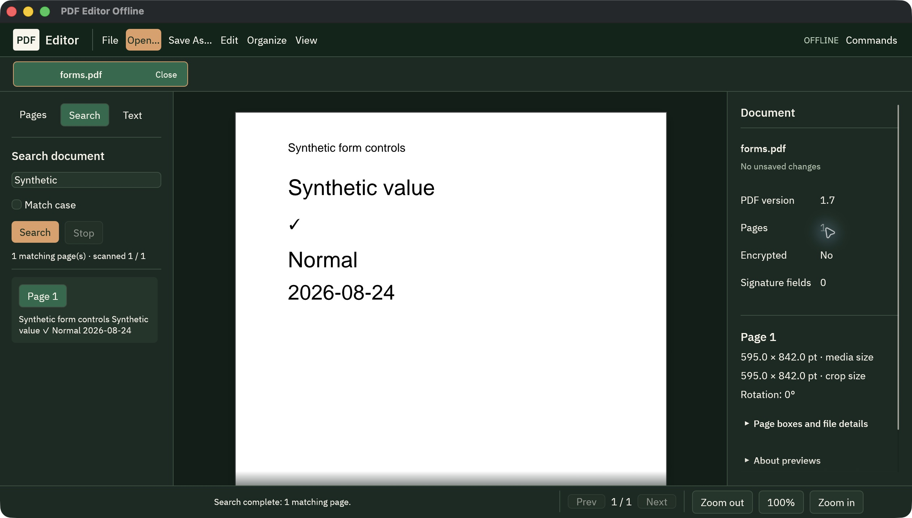

# PDF Editor Offline


**An offline PDF editor built in Rust. Your files stay on your computer.**

[English](README.md) · [Français](docs/languages/fr.md) · [العربية](docs/languages/ar.md) · [Español](docs/languages/es.md) · [Português](docs/languages/pt-BR.md) · [Deutsch](docs/languages/de.md) · [简体中文](docs/languages/zh-CN.md) · [日本語](docs/languages/ja.md) · [한국어](docs/languages/ko.md)

[](https://github.com/OthmaneBlial/pdf-editor-offline/actions/workflows/rust.yml)
[](LICENSE)
[](https://www.npmjs.com/package/pdf-editor-offline)
[](https://github.com/OthmaneBlial/pdf-editor-offline/stargazers)

[Explore the workstation](https://othmaneblial.github.io/pdf-editor-offline/) · [Build guide](https://othmaneblial.github.io/pdf-editor-offline/docs.html#native-build) · [Roadmap](ROADMAP.md)

Open a PDF, find the page you need, organize it and save a new copy. PDF Editor
Offline is a free, open-source desktop app and command-line tool for local PDF
work. No account, subscription or document upload is required.

**Try the native Rust preview.** The CLI is released for macOS, Windows and Linux;
the desktop app builds from source. Actual desktop interaction evidence is
primarily from macOS. Native desktop installers and full PDF editing remain in
progress. [Download the native CLI](https://github.com/OthmaneBlial/pdf-editor-offline/releases/tag/v4.0.0-preview.1);
historical desktop releases have a different feature set.


The screenshot is a real app window using a public synthetic PDF.
[More native captures](screenshots/native/) · [Runtime evidence](docs/NATIVE_DESKTOP_EVIDENCE.md)

## Your next PDF, without the upload

**A few pages for someone else.** Open your document, move the pages into order,
rotate a sideways scan and save a separate copy. Your original stays where it is.

**An answer buried in a long file.** Search for a phrase, jump to the matching
page and use thumbnails to keep your place.

**The same task, every week.** Use the Rust CLI for repeatable page operations
and JSON inspection. Preview a supported change with `--dry-run` before writing.

[Try the CLI ↓](#try-the-native-cli) · [Run the desktop ↓](#build-and-run) ·
[See supported operations ↓](#what-works-today)

<details>
<summary>Take a closer look: pages, properties and the dark workspace</summary>

**Find your page.** Thumbnails follow the document while the canvas gives you room to read.


**Keep the details right.** Edit document properties, including tested Chinese, Japanese and Korean text, then save a verified copy.


**Work after dark.** The same native workspace, with a quieter palette.



These are real macOS captures with synthetic public documents.

</details>

## Try the native CLI

```sh
npm install --global pdf-editor-offline
pdf-editor-offline --help
```

The npm package installs and launches the native Rust CLI; PDF processing stays
local. Its installer and launcher need Node.js 22+. Prefer a standalone binary?
[Download one for your platform](https://github.com/OthmaneBlial/pdf-editor-offline/releases/tag/v4.0.0-preview.1)
and run it directly, without Node.js or a Rust toolchain.

Version **4.0.0-preview.1** passed real binary and global-install checks on macOS
ARM64/Intel, Windows x64 and Linux x64/ARM64. It installs the CLI; build the desktop
app with the instructions below.

## What works today

| Task | Native desktop | Rust CLI |
| --- | --- | --- |
| Read and find | Tabs, zoom, visible-page thumbnails, text sidebar, literal search, light/dark themes | Document info, text extraction, literal search, limited text/geometry comparison |
| Organize pages | Move/reverse pages, rotate, insert blank pages, crop, undo/redo | Reorder/reverse/rotate/crop, insert blank pages, guarded extract/delete, simple-catalog merge |
| Document properties | Read/edit six standard fields, including Unicode | Read/set/remove Title, Author, Subject, Keywords, Creator and Producer |
| Images | Create PDF pages from supported PNG/JPEG files | Restricted images-to-PDF conversion; export one PDF page as PNG |
| Comments | Existing supported appearances can be displayed | Add/list sticky Text notes; guarded editing/removal of basic notes |
| Inspect and export | Verified Save As to a new path | Read-only action/attachment/form/layer markers, lossless stream compression, verified fresh output copies |
| Resume your work | Recorded document/history snapshots, explicit session restore/discard, interrupted-save retry/cancel in current source | Desktop recovery is separate from the CLI |

Supported edits preserve unrelated PDF objects and refuse structures they cannot
safely handle. Merge, page subsets, note editing and image conversion have explicit
scope restrictions; see the [CLI guide](apps/cli/README.md). A smaller compressed
file is not guaranteed.

Cropping hides content. Removing metadata or notes can leave old values in the
file. None of these operations is secure redaction or private-data erasure.
OCR, form filling, digital signing, arbitrary page-text editing and broad document
conversion are not implemented in this preview. Rendering can omit unsupported
content; inspect exported documents before relying on them. Signed inputs and
successfully decrypted inputs are read-only.

The interface is currently English. These README translations do not imply a
localized GUI or complete right-to-left layout support. Offline fonts include
tested Chinese, Japanese and Korean glyphs; they do not cover every script.

## Build and run

Install Rust **1.95+** and your platform's native build prerequisites. The app runs
locally after building; dependency downloads require a connection on the first
build. On Linux, consult the [native CI setup](.github/workflows/rust.yml) for
system packages.

```sh
git clone https://github.com/OthmaneBlial/pdf-editor-offline.git
cd pdf-editor-offline
cargo build --release --locked -p pdf-editor-offline-native -p pdf-editor-offline-cli
./target/release/pdf-editor-offline-native
```

On Windows, run
`target\release\pdf-editor-offline-native.exe`; executable names end in `.exe`.

Try the CLI with the included demonstration file:

```sh
./target/release/pdf-editor-offline info examples/sample_pdfs/demo-basic.pdf --json
./target/release/pdf-editor-offline rotate examples/sample_pdfs/demo-basic.pdf --pages 1 --degrees 90 -o rotated.pdf --dry-run --json
./target/release/pdf-editor-offline rotate examples/sample_pdfs/demo-basic.pdf --pages 1 --degrees 90 -o rotated.pdf --json
./target/release/pdf-editor-offline capabilities --json
```

Pages start at **1**. `--dry-run` validates without writing.
Choose a new output path: existing files and symlinks are never overwritten.

## Local files, reviewable results

PDF operations run on the local machine. The native app uses no remote rendering
or cloud conversion service and requires no account. Local processing does not
make every PDF safe or prove that hidden information has been removed.
[Security inspection scope](docs/SECURITY_INSPECTION_RUST.md) explains what the
read-only report can establish.

The current desktop source keeps private local recovery copies, including PDF
bytes and paths. [Recovery controls](docs/DESKTOP_RECOVERY.md) let you inspect and
discard retained sessions; closing a tab does not securely erase those bytes.

Validation includes Rust tests and independent qpdf/Poppler checks for specific
fixtures and supported operations. The [CLI evidence](docs/RUST_BENCHMARKS.md)
records 44 operation checks, real process timings and input/binary hashes,
including a generated 1,000-page PDF. Those results do not prove all-document
fidelity, desktop responsiveness or a universal speedup.

## Help build it

This is an active native rewrite. Follow the [release notes](CHANGELOG.md),
the [next milestones](ROADMAP.md) and the [implementation status](docs/RUST_STATUS.md)
to see what has shipped and what still needs work. The screenshots above show
the app; the status documents describe its current limits.

Useful contributions include reproducible PDF issues with synthetic fixtures,
renderer comparisons, accessibility testing, translation corrections and small
Rust changes. Please keep private documents out of public reports.

```sh
cargo test --workspace --locked
cargo clippy --workspace --all-targets --locked -- -D warnings
```

[Native status](docs/RUST_STATUS.md) · [Desktop guide](apps/desktop/README.md) ·
[CLI guide](apps/cli/README.md) · [Contributing](.github/CONTRIBUTING.md) ·
[Support](.github/SUPPORT.md) · [Security](.github/SECURITY.md)

If you want a PDF editor that works locally, **star the repository** to help
others find it.

[MIT licensed](LICENSE). Bundled fonts and dependencies retain their own notices.
