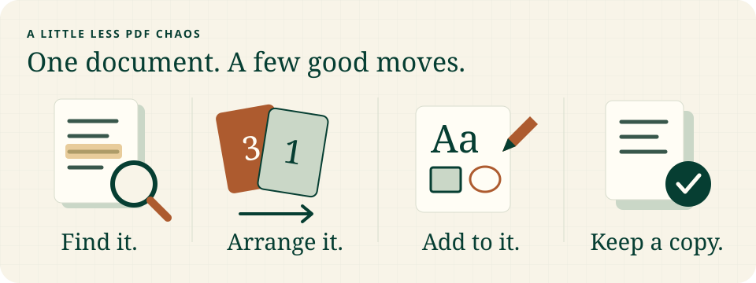
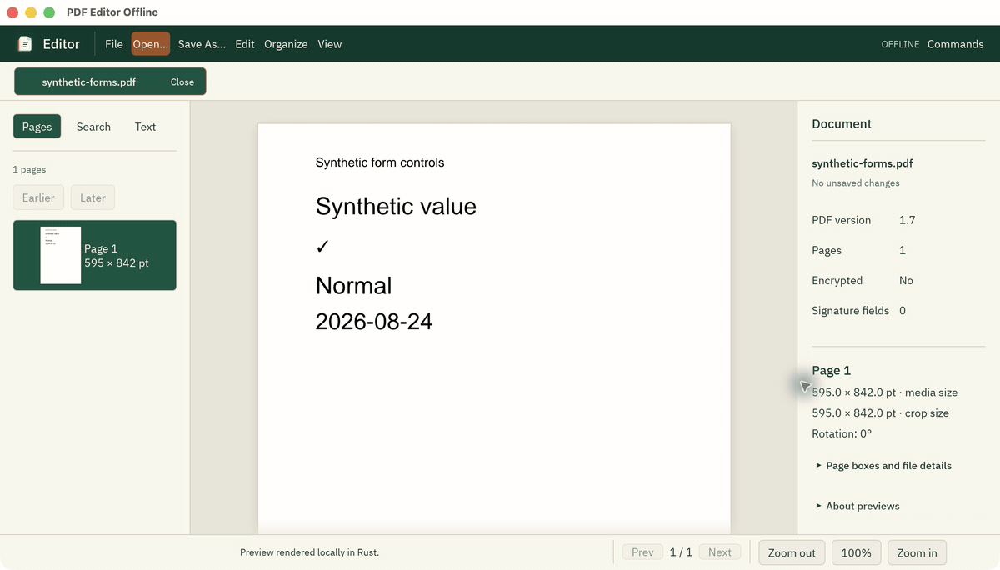
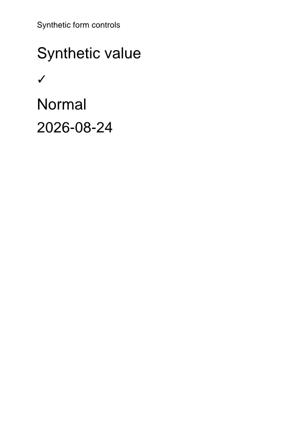
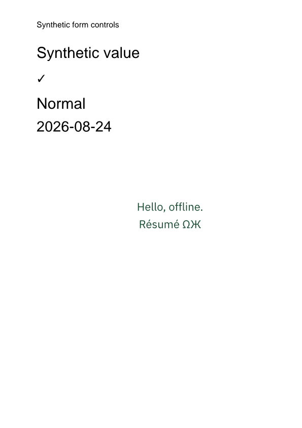
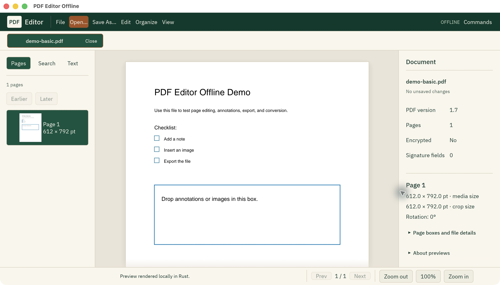
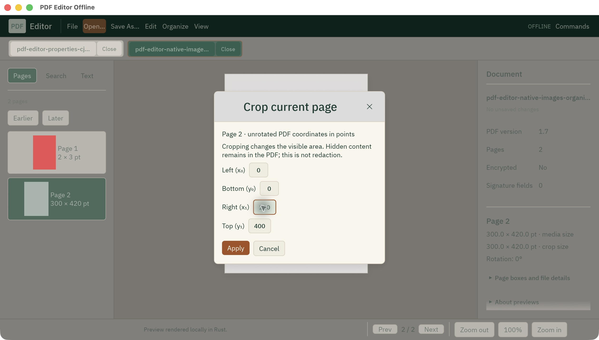
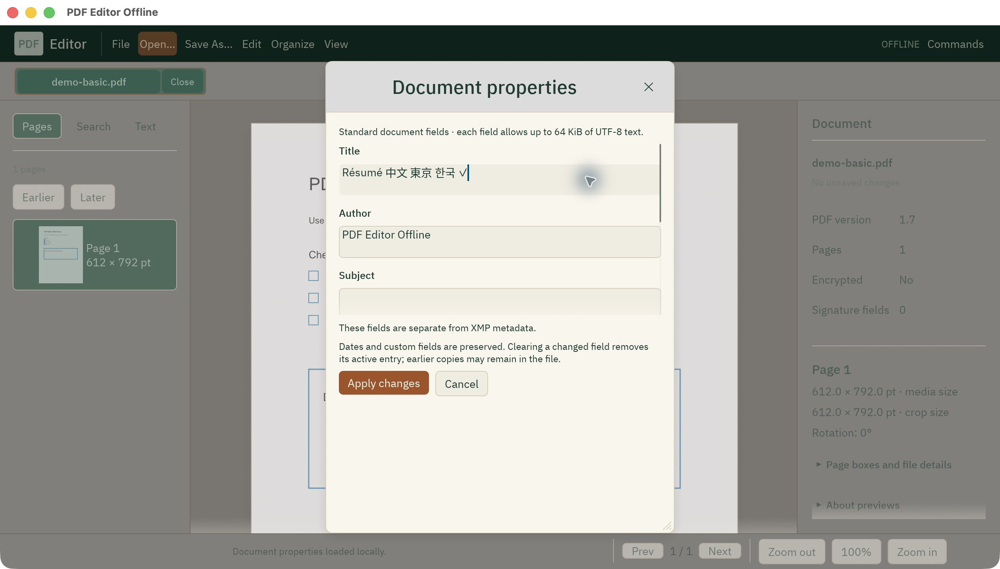
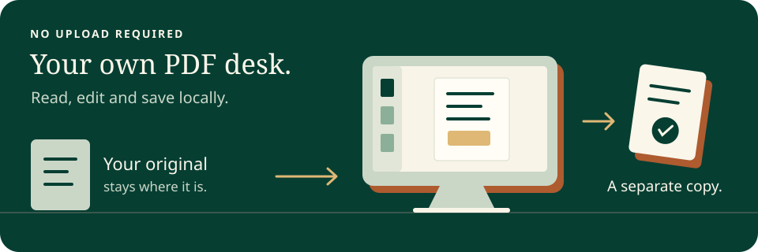
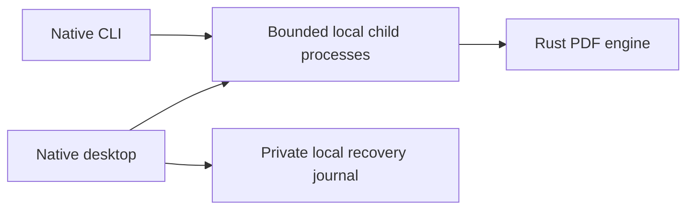

# PDF Editor Offline


**An offline PDF editor built in Rust. Your files stay on your computer.**

[English](README.md) · [Français](docs/languages/fr.md) · [العربية](docs/languages/ar.md) · [Español](docs/languages/es.md) · [Português](docs/languages/pt-BR.md) · [Deutsch](docs/languages/de.md) · [简体中文](docs/languages/zh-CN.md) · [日本語](docs/languages/ja.md) · [한국어](docs/languages/ko.md)

[](https://github.com/OthmaneBlial/pdf-editor-offline/actions/workflows/rust.yml)
[](LICENSE)
[](https://www.npmjs.com/package/pdf-editor-offline)
[](https://github.com/OthmaneBlial/pdf-editor-offline/commits/main/)
[](https://github.com/OthmaneBlial/pdf-editor-offline/stargazers)

[Explore the workstation](https://othmaneblial.github.io/pdf-editor-offline/) · [Build guide](https://othmaneblial.github.io/pdf-editor-offline/docs.html#native-build) · [Roadmap](ROADMAP.md)

## Your PDFs. Your computer.

Finish a form. Put pages in order. Add a note. Save a separate copy.
PDF Editor Offline is a free, open-source PDF workstation and Rust CLI.
No account, subscription or document upload is required.

**[Install the CLI](#try-the-native-cli) · [Run the desktop](#build-and-run) · [See what's next](ROADMAP.md)**

**Available now:** native CLI **4.0.0-preview.3** for macOS, Windows and Linux.
The desktop builds from source; installers and full PDF editing are still in
development. The gallery shows real macOS sessions with public synthetic PDFs.



**A little less PDF chaos.** Find the right page, give it a new order, add a few
words or a drawing, then save a copy. Start with the
[public demo PDF](examples/sample_pdfs/demo-basic.pdf) and try things without
putting a private document in a public example.

### Meet your new desk


The screenshot is a real app window using a public synthetic PDF.
[More native captures](docs/assets/screenshots/native/) · [Runtime evidence](docs/NATIVE_DESKTOP_EVIDENCE.md)

## Made this week · 13 October 2026

**Today's checkpoint:** the combined numbering, image-replacement and original
text-property source and two CI repairs passed **717 local tests**, including the
pinned independent
readers and actual native workers, with no failures or ignored tests. Strict
Clippy passed. All five platforms and the quality job in
[native CI](https://github.com/OthmaneBlial/pdf-editor-offline/actions/runs/38383270114)
passed. The repaired source passed
[security scanning](https://github.com/OthmaneBlial/pdf-editor-offline/actions/runs/38383092873).
The downloadable CLI remains preview.3. [Scope and evidence](docs/RUST_STATUS.md).

These features are on **`main`**, ahead of the published CLI preview:

**Fresh tools to play with:** [draw on the canvas](docs/VECTOR_DRAWING_RUST.md),
[draw a visual signature](docs/VISUAL_SIGNATURES_RUST.md),
[place an image](docs/IMAGE_OVERLAYS_RUST.md),
[replace one existing image](docs/IMAGE_REPLACEMENT_RUST.md),
[number pages](docs/PAGE_NUMBERING_RUST.md),
[edit supported existing text](docs/CONTENT_TEXT_EDITING_RUST.md),
[add Unicode text](docs/TEXT_OVERLAYS_RUST.md), [finish a form](docs/FORMS_RUST.md)
or [leave a sticky note](docs/NOTES_RUST.md). Build the current source to try them.

<details>
<summary>Open this week's workflow notes</summary>

| Try it | See it work |
| --- | --- |
| Add Unicode text with a font, color and alignment | [Before/after exports and commands](docs/TEXT_OVERLAYS_RUST.md) |
| Draw rectangles, ellipses, lines and freehand paths | [Canvas controls and reproducible CLI example](docs/VECTOR_DRAWING_RUST.md) |
| Place a PNG/JPEG on an existing PDF page | [Image placement, resize and rotation](docs/IMAGE_OVERLAYS_RUST.md) |
| Replace one image while keeping its other shared occurrences | [Source-bound replacement and preservation limits](docs/IMAGE_REPLACEMENT_RUST.md) |
| Number selected pages in one undoable operation | [Upright numbering and reproducible commands](docs/PAGE_NUMBERING_RUST.md) |
| Move, resize or recolor supported original text | [Text properties and exact byte preservation](docs/CONTENT_TEXT_EDITING_RUST.md) |
| Fill text fields, dropdowns and list selections | [A public form you can finish](docs/FORMS_RUST.md) |
| Add, edit and remove basic sticky notes with undo | [Desktop note walkthrough](docs/NOTES_RUST.md) |
| Combine supported PDFs into a new desktop tab | [Merge workflow](apps/desktop/README.md) |
| Split supported PDFs into new tabs or CLI files | [Split workflow and publication limits](apps/desktop/README.md) |
| Open a password-protected PDF for this session | [Read-only encrypted viewing](docs/ENCRYPTED_VIEWING_RUST.md) |
| Make a targeted cleanup copy with a removal report | [What sanitization removes](docs/SANITIZATION_RUST.md) |

</details>

### A little image adventure



Six real macOS captures, assembled into a 15-second slideshow: open, choose a
PNG, zoom, insert, undo and save a new copy. The public synthetic source stays
intact. [Inspect the saved PDF and review scope](docs/NATIVE_DESKTOP_EVIDENCE.md#actual-image-insertion-and-save-as--2026-10-13).

### An actual PDF, before and after

| Before | After adding text |
| --- | --- |
|  |  |

These are rendered PDF exports, not interface mockups. Added text does not
replace or erase existing content. [Reproduce the result](docs/TEXT_OVERLAYS_RUST.md).

[Latest changes](CHANGELOG.md) · [Live CI](https://github.com/OthmaneBlial/pdf-editor-offline/actions/workflows/rust.yml)
· [Source status and remaining work](docs/RUST_STATUS.md)

### Pick your first five minutes

**Just looking?** [Open the real gallery](docs/assets/screenshots/native/).
**Ready to try it?** [Install the CLI](#try-the-native-cli) or [build the desktop](#build-and-run).
**Here to make something?** [Recreate the text example](docs/TEXT_OVERLAYS_RUST.md)
or [explore the Rust workspace](Cargo.toml).

If this is a tool you'd use, **[star the repository](https://github.com/OthmaneBlial/pdf-editor-offline)**
to keep it within reach. Want to help it grow? Try a workflow, compare the saved
PDF in another viewer, or contribute a focused improvement from the
[roadmap](ROADMAP.md). Use synthetic documents for public examples.

<details>
<summary>A small root, with a place for everything</summary>

The project is a Rust workspace. Build outputs stay outside this checkout.

| Directory | Purpose |
| --- | --- |
| `apps/` | Native desktop and command-line applications |
| `crates/` | PDF parsing, editing, rendering, conversion and worker isolation |
| `docs/` | Guides, translations, screenshots and verification evidence |
| `distribution/` | The optional npm installer and release preparation |
| `examples/`, `tests/`, `tools/` | Reproducible examples, fixtures and development tools |
| `site/` | The public showcase and documentation website |
| `vendor/` | Required vendored source and its licenses |

The root keeps workspace manifests, project documentation, the license and
quality configuration. Screenshots live in `docs/assets/`.

</details>

## Pick a little PDF adventure

**The tidy-up quest.** Find your page, rotate that sideways scan, put the pages
in order and save a separate copy. Your original stays where it is.

**The one-file handoff.** Choose Edit → **Merge PDF files…** in a desktop source
build, arrange compatible PDFs and create a new document.
[Merge scope and checks](apps/desktop/README.md) explain the guarded tier.

**The fill-it-in moment.** Finish a supported form, add Unicode text or draw a
shape. Try the [form](docs/FORMS_RUST.md), [text](docs/TEXT_OVERLAYS_RUST.md) or
[drawing](docs/VECTOR_DRAWING_RUST.md) walkthrough in a current-source build.

**The repeat job.** Let the Rust CLI handle supported page operations and JSON
inspection. Preview a change with `--dry-run` before writing.

**Before sharing.** [Targeted cleanup](docs/SANITIZATION_RUST.md) can remove
specified metadata, attachments and actions into a new copy. Read its report and
review the retained page content for personal information.

[Try the CLI ↓](#try-the-native-cli) · [Run the desktop ↓](#build-and-run) ·
[See supported operations ↓](#what-works-today)

### Lights down. Document open.


Same app, another mood. This is an actual native window, not a design mockup.

<details>
<summary>Take a closer look: pages, organization and properties</summary>

**Find your page.** Thumbnails follow the document while the canvas gives you room to read.



**Put the pages in order.** Open the organizer to rotate, reorder or crop supported documents.



**Keep the details right.** Edit document properties, including tested Chinese, Japanese and Korean text, then save a verified copy.



These are real macOS captures with synthetic public documents.

</details>

## Try the native CLI

```sh
npm install --global pdf-editor-offline
pdf-editor-offline --help
```

**Start with one file.** Replace `input.pdf` with a local PDF:

```sh
pdf-editor-offline info input.pdf --json
pdf-editor-offline rotate input.pdf --pages 1 --degrees 90 -o rotated.pdf --dry-run --json
pdf-editor-offline rotate input.pdf --pages 1 --degrees 90 -o rotated.pdf --json
```

The first command inspects the document. The next previews a rotation; the last
writes a new copy. Pick an unused output name: existing files are not overwritten.

The npm package installs and launches the native Rust CLI; PDF processing stays
local. Its installer and launcher need Node.js 22+. Prefer a standalone binary?
[Download one for your platform](https://github.com/OthmaneBlial/pdf-editor-offline/releases/tag/v4.0.0-preview.3)
and run it directly, without Node.js or a Rust toolchain.

Version **4.0.0-preview.3** passed real binary and global-install checks on macOS
ARM64/Intel, Windows x64 and Linux x64/ARM64. It installs the CLI; build the desktop
app with the instructions below.

<details>
<summary>Three more things to try with your own PDF</summary>

| You want to… | Run this |
| --- | --- |
| Read document properties | `pdf-editor-offline metadata input.pdf --json` |
| See which operations are supported | `pdf-editor-offline capabilities --json` |
| Check extraction options before choosing pages | `pdf-editor-offline extract-pages --help` |

[Full command guide and examples](apps/cli/README.md)

</details>

## What works today

Read, organize, add text, draw, fill supported forms and save a separate copy.
Each tool has a defined scope; arbitrary existing-text editing, OCR and digital
signing are still ahead. [The full roadmap](ROADMAP.md) shows the remaining work.

**Follow the work as it lands:** [latest commits](https://github.com/OthmaneBlial/pdf-editor-offline/commits/main/)
· [native build results](https://github.com/OthmaneBlial/pdf-editor-offline/actions/workflows/rust.yml)
· [published releases](https://github.com/OthmaneBlial/pdf-editor-offline/releases).
The table covers current source; published CLI differences are called out below.

<details>
<summary>Show the full desktop and CLI feature matrix</summary>

| Task | Native desktop | Rust CLI |
| --- | --- | --- |
| Read and find | Tabs, zoom, visible-page thumbnails, text sidebar, literal search, light/dark themes | Document info, text extraction, literal search, limited text/geometry comparison |
| Organize pages | Move/reverse pages, rotate, insert blank pages, crop, guarded ranges, split into new tabs, ordered simple-catalog merge, undo/redo | Reorder/reverse/rotate/crop, blank insertion, guarded extract/delete/duplicate, merge and `split --every N --output-dir NEW` in current source |
| Document properties | Read/edit six standard fields, including Unicode | Read/set/remove Title, Author, Subject, Keywords, Creator and Producer |
| Images | Create PDF pages from supported PNG/JPEG files; place, resize and quarter-turn a new image on an existing page with protected drafts and history | Restricted images-to-PDF conversion; export one PDF page as PNG; current-source `add-image-overlay` with dry-run and new-copy saving |
| Comments | Bounded sticky-note discovery, guarded add/edit/remove, durable history; supported appearances and standard Text/FileAttachment icons | Add/list sticky Text notes; guarded editing/removal of basic notes |
| New page text | Drag placement, move/eight resize handles, snapping and arrow nudges, numeric controls, covering-font picker, guarded apply and durable undo/redo | `add-text-overlay` adds bounded Unicode text with an explicit font, rectangle, color and alignment in current source |
| Existing text | Select and replace supported ordinary Courier ASCII operands; source-bound drafts, undo/redo and verified Save As | `inspect-content-text` and `replace-content-text` with exact source identity, dry-run and new-copy saving; equal-length, equal-space-position tier |
| New drawings | Rectangles, ellipses, lines and bounded freehand paths, colors/paint opacity, snapping, nudges and protected drafts | `add-vector-overlay` with a strict JSON request, dry-run and fresh-copy saving in current source |
| Visual signatures | Separate pen strokes and dots, color/width, one Apply and one durable Undo; **Sign → Draw visual signature…** | `add-vector-overlay` accepts bounded `multi_polyline` strokes; artwork only, without certificate signing or identity verification |
| Forms | Checkboxes/radios, single/multiline text, dropdowns and single/multiple list selections; guarded apply and undo/redo | Discover fields and indexed options; `fill-button`, `fill-text`, `list-choices` and `fill-choice` in current source |
| Inspect and export | Verified Save As to a new path | Read-only action/attachment/form/layer markers, lossless stream compression, verified fresh output copies |
| Targeted cleanup | Separate unsaved copy, removal report and verified Save As | `sanitize` removes supported metadata/file/action structures through a full rewrite in current source; includes dry-run and a partial-scope report |
| Resume your work | Recorded document/history snapshots, explicit session restore/discard, interrupted-save retry/cancel in current source | Desktop recovery is separate from the CLI |

</details>

Supported edits preserve unrelated PDF objects and refuse structures they cannot
safely handle. Merge, page subsets, note editing and image conversion have explicit
scope restrictions; see the [CLI guide](apps/cli/README.md). A smaller compressed
file is not guaranteed.

[Page duplication](docs/DESKTOP_PAGE_RANGES.md#duplicate) is available in the
published `4.0.0-preview.3` CLI.

Cropping hides content. Removing metadata or notes can leave old values in the
file. None of these operations is secure redaction or private-data erasure.
[Targeted sanitization](docs/SANITIZATION_RUST.md) removes specified structures
and unreachable payloads from a new copy. It preserves page content and can leave
other private information; its report explicitly provides no general privacy proof.
OCR, advanced text form filling, digital signing, arbitrary page-text editing and broad document
conversion are not implemented in this preview. Rendering can omit unsupported
content; inspect exported documents before relying on them. Signed inputs and
successfully decrypted inputs are read-only.

[Try the form fixture](docs/FORMS_RUST.md): buttons preserve existing appearances;
single/multiline text embeds a complete covering TrueType or supported CID-keyed CFF1
font. Missing glyphs and unsupported layouts are refused. Button filling is in the
published `4.0.0-preview.3` CLI; text and choice generation are available in current
source. Choice selections use explicit option indices, including when export
values are duplicated. Text and choices require a covering font.

The interface is currently English. These README translations do not imply a
localized GUI or complete right-to-left layout support. Offline fonts include
tested Chinese, Japanese and Korean glyphs; they do not cover every script.

## Build and run

Install Rust **1.95+** and your platform's native build prerequisites. The app runs
locally after building; dependency downloads require a connection on the first
build. On Linux, consult the [native CI setup](.github/workflows/rust.yml) for
system packages.

```sh
git clone https://github.com/OthmaneBlial/pdf-editor-offline.git
cd pdf-editor-offline
export CARGO_TARGET_DIR="${TMPDIR:-/tmp}/pdf-editor-offline-build"
cargo build --release --locked -p pdf-editor-offline-native -p pdf-editor-offline-cli
"$CARGO_TARGET_DIR/release/pdf-editor-offline-native"
```

This keeps the build cache outside the project root. On Windows PowerShell, set
`$env:CARGO_TARGET_DIR = Join-Path $env:TEMP 'pdf-editor-offline-build'` before
building, then run `& "$env:CARGO_TARGET_DIR\release\pdf-editor-offline-native.exe"`.

<details>
<summary>Keep going: four CLI commands with the demo PDF</summary>

Try the CLI with the included demonstration file:

```sh
"$CARGO_TARGET_DIR/release/pdf-editor-offline" info examples/sample_pdfs/demo-basic.pdf --json
"$CARGO_TARGET_DIR/release/pdf-editor-offline" rotate examples/sample_pdfs/demo-basic.pdf --pages 1 --degrees 90 -o rotated.pdf --dry-run --json
"$CARGO_TARGET_DIR/release/pdf-editor-offline" rotate examples/sample_pdfs/demo-basic.pdf --pages 1 --degrees 90 -o rotated.pdf --json
"$CARGO_TARGET_DIR/release/pdf-editor-offline" capabilities --json
```

Pages start at **1**. `--dry-run` validates without writing.
Choose a new output path: existing files and symlinks are never overwritten.

</details>

### Your first desktop session

Use the included [demonstration PDF](examples/sample_pdfs/demo-basic.pdf) to explore
the app before opening your own documents:

1. Open `examples/sample_pdfs/demo-basic.pdf` in the native desktop.
2. Search for a word on the page, then open the page organizer and rotate it.
3. Undo the rotation, try the dark theme and edit a document property.
4. Use **Save As** with a new filename, then reopen your saved copy.

The [desktop guide](apps/desktop/README.md) explains the controls and supported
document structures. The gallery above shows actual macOS sessions with this
public sample, so you can compare the workspace before building.

## Local files, reviewable results



PDF operations run on the local machine. The native app uses no remote rendering
or cloud conversion service and requires no account. Local processing does not
make every PDF safe or prove that hidden information has been removed.
[Security inspection scope](docs/SECURITY_INSPECTION_RUST.md) explains what the
read-only report can establish.

The current desktop source keeps private local recovery copies, including PDF
bytes and paths. [Recovery controls](docs/DESKTOP_RECOVERY.md) let you inspect and
discard retained sessions; closing a tab does not securely erase those bytes.

Validation includes Rust tests and independent qpdf/Poppler checks for specific
fixtures and supported operations. The [CLI evidence](docs/RUST_BENCHMARKS.md)
records 44 operation checks, real process timings and input/binary hashes,
including a generated 1,000-page PDF. Those results do not prove all-document
fidelity, desktop responsiveness or a universal speedup.

## Help build it


This is an active native rewrite. Follow the [release notes](CHANGELOG.md),
the [next milestones](ROADMAP.md) and the [implementation status](docs/RUST_STATUS.md)
to see what has shipped and what still needs work. The screenshots above show
the app; the status documents describe its current limits.

**Help shape the next preview:** try the supported form workflow, compare a
synthetic PDF in another reader or improve one of the nine README translations.
[Release preparation](distribution/npm/RELEASE_PREPARATION.md) records the next
release's remaining checks. The npm badge above reflects the public registry.

**Choose a starting point:** [use the CLI](apps/cli/README.md),
[run the desktop](apps/desktop/README.md),
[contribute a fix](.github/CONTRIBUTING.md) or
[improve a translation](docs/languages/).

<details>
<summary>How the Rust pieces fit together</summary>



Desktop and CLI document processing use bounded local children. The released CLI
`4.0.0-preview.3` includes this isolation; see [CLI controls](docs/CLI_ISOLATION.md).
No document upload service is used.
[Architecture](docs/ARCHITECTURE.md) · [Public Rust API](crates/pdf-core/README.md)

</details>

Useful contributions include reproducible PDF issues with synthetic fixtures,
renderer comparisons, accessibility testing, translation corrections and small
Rust changes. Please keep private documents out of public reports.

```sh
cargo test --workspace --locked
cargo clippy --workspace --all-targets --locked -- -D warnings
```

[Native status](docs/RUST_STATUS.md) · [Desktop guide](apps/desktop/README.md) ·
[CLI guide](apps/cli/README.md) · [Contributing](.github/CONTRIBUTING.md) ·
[Support](.github/SUPPORT.md) · [Security](.github/SECURITY.md)

If you want a PDF editor that works locally, **star the repository** to help
others find it.

[MIT licensed](LICENSE). Bundled fonts and dependencies retain their own notices.
