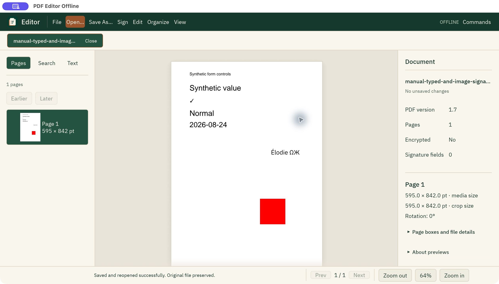

# Native desktop milestone

Current source's existing-text **Font face** pane accepts a chosen static TTF,
optional covered Unicode and explicit width-change acknowledgement. The real
picker, retained drafts, source identity, worker, durable Undo/Redo and verified
Save As reuse the existing properties workflow. The chosen font preserves the
original text size and matrix; new ink/width can overlap artwork. Unsupported
fonts, source structures, missing glyphs, CFF/RTL and reflow are refused.
[Actual font tier and caller checks](../../docs/EXISTING_TEXT_FONT_RUST.md).
Headless controls and production-native child/output proof do not establish a
manual window review or change the published preview.

**Edit → Remove complete images into new copy…** opens the real source-bound
image inventory. Include individual draws across pages and confirm the complete
asset selection. A fresh unsaved tab appears only after two bounded child checks
and a durable journal commit; the original tab and its history remain unchanged.
Save As publishes a verified no-clobber copy. Shared image/mask uses must all be
selected; otherwise the source and draft are retained with a refusal. Remaining
text must use strict ASCII/unembedded standard Type1 fonts. Current
scope is RGB/Gray8 plain/Flate images with grayscale soft masks. JPEG, predictors,
ICC and opaque carriers refuse. Source plus verification output is capped at
128 MiB. The full rewrite also removes supported metadata, attachment and action
carriers; actual categories are reported. Original files and recovery copies
remain. This is not partial-pixel redaction or a general privacy certificate.
Controls and production child/save behavior are tested; manual window interaction
is not established by the headless tests.

Sign → **Type a visual signature…** and **Add visual signature image…** reuse
the text and image overlay dialogs, with a chosen covering font or PNG/JPEG asset,
real placement controls, durable Undo/Redo and verified Save As. These are visual
artwork, with no certificate signing, signature field, identity verification or
tamper protection. Asset files remain unchanged; no signature library is created.
Applied artwork is part of the PDF and its normal history/recovery copies.
Unapplied drafts are protected by close/quit guards and are not restored by recovery.
An [actual macOS window review](../../docs/VISUAL_SIGNATURES_NATIVE_REVIEW.md)
verified both pickers, typed Unicode, draft protection, Apply and new-copy saving,
with independent saved-output checks. Manual short-window and canvas drag/resize
coverage remain open; 640×420 headless controls are separate evidence.
The published preview remains separate from these source changes.



The explicit signature output gate exercises the normal executable's
`--pdf-worker` entry, typed Unicode extraction, image placement, source/form
preservation, durable history, no-clobber saving and pinned independent raster checks:

```sh
cargo build --locked -p pdf-worker --features test-helper -p pdf-editor-offline-native
PDF_QPDF_BIN=/path/to/qpdf-12.4.2 \
PDF_REFERENCE_BIN_DIR=/path/to/poppler-26.10/bin \
cargo test --locked -p pdf-editor-offline-native production_typed_and_image_visual_signatures_preserve_saved_artwork -- --ignored
```

Current source includes **Edit → Number pages…** and a working command-palette action.
An explicit page range, starting integer, header/footer band, margin, font size,
RGB color, alignment and covering font create one atomic batch and one durable
Undo/Redo history entry. Numbers stay upright on rotated visible pages. Stale,
read-only and pending-save guards apply; unapplied settings require explicit
discard. See [page-numbering scope](../../docs/PAGE_NUMBERING_RUST.md).
Headless widget and real subprocess checks do not establish a new manual window review.

Edit → **Create permanent text redacted copy…** accepts exact ASCII targets,
requires explicit confirmation, and creates a separate unsaved tab. A bounded
child removes matching glyphs and supported metadata/attachment/action/comment
carriers; a second child verifies the actual returned bytes before the copy is
journaled and acknowledged. The new tab has no undo history containing the source
secret. Save As writes a verified new file; the original tab, its history and other
recovery copies remain. Drafts survive errors and participate in close/quit guards.
The versioned semantic-text profile accepts standard Latin Type1 fonts, inherited
font/size, bounded spacing/rise/line moves, filled or invisible text, and one
uniform full-page background; arbitrary painted paths, clipping, transforms,
images and opaque structures refuse. This is not general privacy verification or
arbitrary-PDF redaction. [Proof boundary](../../docs/TEXT_REDACTION_RUST.md).
Retained glyph positions are preserved; reader heuristics can reorder extraction
after the new blank gaps.
Automated keyboard/pointer controls and real subprocess saved-output checks pass;
manual interaction with the native dialog remains unverified.

Edit → **Draw shapes and freehand…** places new rectangles, ellipses, lines and
bounded freehand paths on the page canvas. Stroke/fill color, width, paint opacity,
snapping, numerical coordinates and keyboard nudges are available. Changing tools
retains the drawing until explicit discard. Apply uses the isolated worker and
durable history; Undo/Redo and verified Save As preserve the original file.
[Drawing walkthrough and limits](../../docs/VECTOR_DRAWING_RUST.md). Automated
controls and independent output checks pass; manual native interaction remains
open. Drawing over content is not redaction.

The **PDF form fields…** action and command palette expose bounded AcroForm
discovery and guarded checkbox/radio editing. Apply uses the actual document
worker and durable history, with undo/redo, verified Save As, stale/tab/save guards
and retained errors. Supported text fields use the font-backed tier described below;
Indexed dropdowns and list selections use the same guarded font-backed workflow;
signature fields remain read-only, and password values are
omitted. [Form guide and limits](../../docs/FORMS_RUST.md). Automated controls and
real document/history tests pass; visual review of this new dialog remains open.

The Organize menu now offers [page-range extraction, duplication and deletion](../../docs/DESKTOP_PAGE_RANGES.md), including deletion confirmation, unsaved extracted tabs and durable undo/redo. Duplication is also available in the command palette; each copy follows its original and the original page keeps focus. These are current-source features; real interaction with the new duplication dialog remains unverified.

```sh
cargo run -p pdf-editor-offline-native
```

Edit → **Add text overlay…** adds new Unicode page content through an isolated
worker, with PDF-space placement controls, a true canvas outline, covering-font
picker, color/size/alignment and durable Undo/Redo. Unapplied drafts are retained
on errors and protected when closing. This is not existing-text editing or
redaction. Canvas drag placement, move/eight resize handles, snapping and focused
arrow nudges are available for new drafts; manual window review remains open.

Opening a protected PDF presents an explicit masked password dialog. Supported
encrypted files open read-only for the current session; credentials and decrypted
snapshots are not retained in recovery. See [encrypted viewing](../../docs/ENCRYPTED_VIEWING_RUST.md).
[Overlay workflow and actual PDF exports](../../docs/TEXT_OVERLAYS_RUST.md).

Edit → **Sticky notes on this page…** lists bounded Text annotations on the
current page, including hidden notes. Each batch contains at most 128 notes and
512 KiB of text; Next notes continues the list. This native tier accepts at most
64 KiB of contents and 1 KiB of author/title per note; oversized existing text is
refused rather than truncated. Add a yellow note with an explicit rectangle in
unrotated PDF points. Existing eligible notes support contents/author edits and
confirmed removal; geometry, flags and appearance remain unchanged during edits.
The core reports read-only reasons for linked, named, locked or unsupported notes.
Signed/encrypted documents, stale revisions and unresolved saves cannot be edited.
Edits enter durable Undo/Redo history before success, and Save As creates a
verified new copy. Removal is ordinary editing: old objects, recovery/history
copies and original files can retain the contents. No secure-erasure claim is made.
Headless controls and production worker/save tests cover this workflow; real
window and platform accessibility review remain open.

The explicit independent notes gate uses the normal native executable and pinned
reference tools to check qpdf metadata/structure, unchanged page-content bytes,
exact Poppler text/pixels, durable history and source-file preservation:

```sh
cargo build -p pdf-worker --features test-helper -p pdf-editor-offline-native --locked
PDF_QPDF_BIN=/path/to/qpdf-12.4.2 \
PDF_REFERENCE_BIN_DIR=/path/to/poppler-26.10/bin \
cargo test -p pdf-editor-offline-native production_native_notes_preserve_page_content_pixels_metadata_and_verified_new_copy --locked -- --ignored
```

Edit → **Merge PDF files…** and the command palette create a separate unsaved
document with the current PDF first. Add PDFs through the native file picker,
then move or remove entries before applying. The guarded simple-catalog tier
requires matching inert metadata and refuses unsupported forms, bookmarks,
attachments, layers, tags, links/actions or signed/encrypted inputs. Combined
input bytes are limited to 128 MiB. Original files, the source tab and its undo
history are retained; the new snapshot is journaled before success. Save As
publishes a verified new file without overwriting an existing destination.
This is partial merge support, not arbitrary PDF compatibility or sanitization.
The native picker and platform accessibility still require manual runtime review.

The explicit production-child merge gate checks saved output, source preservation,
text/geometry and exact Poppler pixels with pinned reference tools:

```sh
cargo build -p pdf-worker --features test-helper -p pdf-editor-offline-native --locked
PDF_QPDF_BIN=/path/to/qpdf-12.4.2 \
PDF_REFERENCE_BIN_DIR=/path/to/poppler-26.10/bin \
cargo test -p pdf-editor-offline-native production_native_merge_and_saved_copy_pass_independent_text_pixels_geometry_checks --locked -- --ignored
```

Edit → **Create targeted sanitized copy…** and the command palette remove
supported Info/XMP, embedded-file associations, attachment annotations, actions
and automatic triggers into a separate unsaved tab. The source bytes and history
are retained. The new snapshot is journaled before success; errors, stale requests,
tab/resource limits or unresolved saves cannot partially replace the source.
The dialog reports removed categories and keeps the incomplete-privacy limitation
visible. Save As publishes the verified full rewrite without overwriting a file.
This is not text/image redaction or proof that no private data remains. Default
FileAttachment fallback icons still do not display in the native renderer; their
supported removal is independently checked with Poppler. See the
[targeted removal scope](../../crates/pdf-core/README.md). Headless control/actor
tests and actual bounded child tests cover the implementation; manual review of
this new dialog and platform accessibility behavior remains open.

Eframe/egui 0.36.2 provides a native accessible widget tree and window; rfd provides native file dialogs. The app runs without a web server, webview or remote renderer. A background coordinator sends document operations to bounded child processes using the app's own `--pdf-worker` entry point. A one-slot command channel and one active UI request prevent render-request accumulation. Page, zoom, document and revision keys discard stale results.

Open up to 16 PDF tabs, navigate pages, zoom, change dark/light theme, rotate and organize pages, create PDFs from images, undo/redo, and Save As. The workstation has a resizable Pages/Search/Text sidebar, a document/page inspector, a centered page canvas, real action menus, a command palette and bottom status/navigation. The inspector collapses below a 960-point window width; extracted text remains available in the sidebar. Original paths are never overwritten. Save uses the core's validated, no-clobber atomic write. Signed and encrypted inputs are read only. Certificate signing, OCR, arbitrary-PDF redaction, arbitrary existing-content editing and other conversion formats remain unimplemented; the supported text-redaction profile is described above. A successful preview does not establish PDF fidelity; unsupported content may be omitted by Hayro.

File → PDF form fields discovers bounded AcroForm fields. Eligible checkboxes and radio buttons use their existing appearances. Supported text fields have single/multiline editors; Enter adds a line break in eligible multiline fields, and Unicode wrapping must fit without truncation; eligible dropdowns and lists expose authoritative zero-based option indices, with checkboxes for multi-selection and an optional first-visible list index. Duplicate display/export labels remain distinct by index. Text and choice changes share a native font-file picker; Apply embeds one complete, editable TrueType or supported static CID-keyed CFF1 OpenType font that must cover the changed text and choice labels. Missing glyphs, unsupported fonts/layouts and values that do not fit return an error beside the retained draft. Button, text and choice changes publish as one verified child result and one durable history transaction; Undo/Redo and guarded Save As preserve the original. Editable combo free-entry, signatures and other unsupported fields remain read only. Stale revisions, signed/encrypted inputs or unresolved save attempts cannot apply drafts. This is form editing, not arbitrary content editing or secure erasure. Headless tests exercise actual controls and document operations; native font-picker and platform accessibility behavior require manual runtime verification.

File → Images to PDF opens a native multiselect PNG/JPEG picker and converts on the existing worker. Images become pages in the picker's returned order; Organize can change that order afterward. Each source pixel occupies one PDF point, without guessing print density. A successful conversion opens a new unsaved tab with real previews and normal editing/history. No file is written until guarded Save As creates a verified new copy. Unsupported formats, orientation/color metadata, invalid input or resource failures leave existing tabs and edits intact. At most 16 tabs may be open. Regular input files are read with at most 32 MiB per image and 128 MiB total before decoding; additional codec/dimension bounds remain enforced by [the supported conversion tier](../../crates/pdf-convert/README.md). This includes restricted noninterlaced PNG and baseline/progressive Gray/RGB/YCbCr JPEG; EXIF orientation, custom color profiles and other unsupported metadata are refused with a user-visible error. The converter does not sanitize retained JPEG metadata or provide OCR.

Organize moves the current page one position earlier/later, reverses all pages, inserts a blank page at a chosen position, or changes the current page's CropBox. Blank dimensions and crop coordinates use PDF points; crop coordinates describe the unrotated page. Cropping hides content without removing it and cannot redact sensitive content. These actions use core operations on a candidate document, then serialize successfully before adding one history snapshot. Failed operations retain the open document and history. Moves, reverse and blank insertion follow the affected page after applying; undo/redo restores document contents and bounds the current page selection to the restored page count. Edits invalidate page previews, thumbnails, extracted text and search results. Signed/encrypted inputs cannot open edit dialogs or run these worker mutations. The core rejects unsafe reordering/insertion with indexed page labels; its error is shown instead of silently discarding those labels.

File → Document properties reads Title, Author, Subject, Keywords, Creator and Producer on the worker. Signed/encrypted documents expose selectable read-only values. Each field allows at most 64 KiB of UTF-8 with no NUL characters; Apply requires valid changed fields. Clearing a changed field removes its active standard entry. Dates, custom entries, aliases and XMP stay unchanged; XMP can contain different values. Removed values may remain elsewhere, so editing properties is not secure erasure. Applying creates one undo snapshot; Save As writes a verified new copy. Failed updates retain drafts, and unapplied changes guard quitting. Tab, revision and generation checks reject stale results. Stale loaded drafts stay read only and copyable until explicitly closed; undoing to an old revision does not reactivate them. Stored Unicode is preserved. Common CJK glyphs were checked in the actual properties window, but the bundled fonts do not cover every script or bidirectional layout.

The Pages sidebar renders real thumbnails only for visible virtualized rows, retaining at most 16 requested keys. Opening a thousand-page PDF does not rasterize all its pages. Thumbnails share the existing worker: main page rendering, page text and search take priority at the next dispatch; an in-flight render cannot be interrupted. Thumbnail keys include document, revision, page and display scale. A shared LRU retains at most 128 entries and 8 MiB of texture RGBA pixel payloads across tabs; failed previews also count toward the entry limit. The cache excludes driver overhead and transient upload/render copies. Thumbnails fit a 72-point box and cap physical dimensions at 512 pixels per side. Edits, closing a tab and display-scale changes invalidate affected entries. Page-selection buttons retain text labels and selected state when a thumbnail is loading or unavailable.

Search extracts actual text one page at a time on the worker and matches a literal query, with optional case sensitivity. Case-insensitive matching uses Unicode lowercase equivalence. Results select the matching page and show an excerpt with compact whitespace; the Text sidebar retains the original extracted text. Search does not provide page-coordinate highlights. Searches stop at 200 matching pages, queries allow 256 characters, and page text is capped at a UTF-8 boundary within 1 MiB. The UI reports partial search/text limits. A read-only selectable page-text control exposes the extracted text through the widget accessibility tree; actual platform screen-reader behavior remains unverified. Search generation, document and revision keys discard stale results. Edits clear scanned counts and old results while retaining the query and case preference. New page renders take priority over subsequent search pages.

The native UI embeds unmodified IBM Plex Sans Regular and Medium for offline body, button and heading typography. The warm ivory light theme and forest/ink dark theme share a restrained copper accent, consistent spacing and readable focus/selection states. Font source pins, payload hashes and the required license are in [IBM Plex provenance](assets/fonts/ibm-plex/PROVENANCE.md). Noto Sans Symbols 2 supplies symbols such as `✓`; its source and OFL notice are in [Noto provenance](assets/fonts/PROVENANCE.md). The final offline fallback is unmodified Noto Sans CJK SC Regular, with actual atlas tests for Chinese, Japanese and Korean glyphs; see [CJK provenance](assets/fonts/noto-cjk/PROVENANCE.md). Native distributions must include `assets/fonts/OFL.txt`, `assets/fonts/ibm-plex/OFL.txt` and `assets/fonts/noto-cjk/LICENSE`, together with their copyright notices. These fonts do not guarantee every script, regional glyph variant or bidirectional layout.

The compact forest header groups working menus/actions. Active document tabs retain accessible selection state, sidebars have deliberate spacing, the page sits on a calm ivory/ink canvas, and the inspector keeps long file paths in a tooltip instead of occupying the reading area. The inspector scrolls vertically in short windows. Narrow windows use File-menu Open/Save actions when the direct buttons do not fit. Light is the initial theme; View or the command palette switches to dark. Theme tests check consistent widget/type colors and at least 4.5:1 contrast for critical text pairs; that is not a complete accessibility audit.

Closing a modified tab or quitting with unsaved changes prompts before discarding. Save failures keep the edits and document open. File → Recovery lists retained sessions for explicit restore/discard; committed document changes and history are recorded before successful UI acknowledgement. Unresolved saves offer retry verification or explicit cancellation. Default quitting retains open documents; unapplied property drafts are not restored. See [private storage and recovery limits](../../docs/DESKTOP_RECOVERY.md).

Main preview caches retain at most 64 MiB of RGBA pixels across tabs, evicting other tabs when necessary; this counts pixel payloads, not driver allocations or transient copies. Eight combined undo/redo snapshots and 256 MiB of serialized snapshots per document are bounded by a 512 MiB aggregate budget across sixteen tabs. These accounting limits do not measure total process memory. Child resource limits do not provide a filesystem or network sandbox.

Page rasterization uses logical document zoom × the window's physical pixels-per-point ratio. A Retina display therefore renders two pixels per logical point at 100% zoom, while the canvas divides the raster size by that ratio. Device ratio, logical zoom and actual raster scale are part of each request key; monitor/DPI changes invalidate stale cached or pending images. The visible CropBox/MediaBox intersection and page rotation determine a safe raster plan. Output remains limited to 8192 pixels per side and 16,777,216 pixels total. If the requested physical resolution would exceed those bounds, the raster resolution is reduced while desired logical page size and zoom remain unchanged, and the canvas reports the resolution limit.

Keyboard: Command/Ctrl+O opens, Command/Ctrl+S saves a new copy, Command/Ctrl+Z undoes, Command/Ctrl+Shift+Z redoes, Command/Ctrl+W closes a tab, Command/Ctrl+F shows Search and focuses its query, Command/Ctrl+K opens the command palette, Command/Ctrl+Q quits, and left/right arrows change pages when no widget has keyboard focus. File → Quit, the Quit palette action, the keyboard shortcut and the window close button share the same unsaved/busy-operation guard. The palette supports a filtered working-action list, Enter to execute the first enabled match, and Escape to dismiss.

On macOS, Winit's default native application menu is disabled because its Quit command directly terminates the process before the unsaved-change guard runs. The application's File → Quit action and logical Command+Q shortcut use the guarded route, verified with a real dirty document. Native Dock/system termination is a separate unverified path.

Forty-nine tests cover history, stale results, no-clobber saving, real-PDF search/query focus/typing, Unicode and result limits, Stop/completion, search reset after edits, initial visibility, actual font-atlas glyphs and themes/contrast. Organizer tests verify real text order, blank insertion, crop bounds, save/reopen, undo, signature guards and failed-edit preservation. Image tests verify ordered PNG pages/pixels, unsaved history, verified saves, bounded inputs, failure preservation and tab limits. Metadata tests verify Unicode, dates/custom fields/XMP/aliases, history, invalid/stale/signed guards and retained drafts in small/large headless UI passes; painted Apply/Cancel labels remain within their clipping bounds at two window sizes. The worker tests fixed note screen footprints at zoom 2/DPR 1 and 2. Thumbnail tests verify actual pixels, bounded LRU eviction, stale/forged keys, visible-only thousand-page scheduling and foreground priority. [Runtime evidence](../../docs/NATIVE_DESKTOP_EVIDENCE.md) records earlier light/dark/compact workstations and subsequent actual thumbnails, CJK properties/save, single-image import and blank-page insertion/movement/save/undo/redo. Broader organizer, multiple-file picker and latest dark/compact properties interactions remain unverified. Accessibility activation/value assignment did not reliably focus search or change numeric steppers; focused keyboard entry worked. Exposed text is not a complete screen-reader audit.

DPI tests exercise physical 2× rendering of a real synthetic PDF, unchanged logical display dimensions, DPI-stale result rejection, crop/rotation, nonfinite input rejection and exact ceiling-aware output limits. Retina sharpness was visually checked on macOS; multimonitor transitions and oversized-document limit messaging remain unverified at runtime.

Split into new tabs copies consecutive page groups through the bounded child.
The source and its undo history stay unchanged; all new unsaved tabs are committed
in one recovery manifest before success. The 16-tab limit and 128 MiB aggregate
serialized output limit apply. Structures that the guarded subset engine cannot
remap are refused. Signed and encrypted inputs remain read-only.

Splitting can retain unreachable objects containing other pages' data. It is not
privacy cleanup or secure redaction. Save As publishes each tab separately; it is
not an atomic multi-file save. The CLI `split --every N --output-dir NEW` instead
creates a fresh directory and reports exact completed files on a publication
failure. It never deletes preexisting files or claims a partial batch succeeded.

The production-child split gate verifies every saved chunk against independent
readers, including text, images, page boxes, rotations and source preservation:

```sh
PDF_QPDF_BIN=/path/to/qpdf PDF_REFERENCE_BIN_DIR=/path/to/poppler/bin \
cargo test -p pdf-editor-offline-native production_native_split_saved_chunks_pass_independent_text_pixels_geometry_checks --locked -- --ignored
```

The split dialog has headless control and stale-result tests. Manual desktop
interaction has not been verified for this milestone.

Insert image content opens a PNG/JPEG picker and a draft placement frame. On
Place on page, drag outside the frame to choose a rectangle, drag inside to move,
and drag a corner to resize. Arrow keys move by one PDF unit (Shift: ten; Alt:
0.1). The frame uses the same crop/rotation mapping as text placement. Numeric
PDF coordinates and 0/90/180/270 counterclockwise rotation are also available.
The rectangle controls size and can stretch aspect ratio. Actual image pixels
appear after Apply; the frame is a guide, not an image preview.

The parent reads a bounded regular file; the child receives only PDF/image bytes,
decodes through `pdf-convert`, and returns a verified PDF. The actor commits the
new snapshot/history to the journal before success. Undo/Redo and Save As retain
the original PDF and image. Stale/other-tab drafts, signed/encrypted inputs,
pending saves, unsupported color/orientation data, tagged pages and budget errors
are refused without changing committed state. Image input is at most 32 MiB;
PDF/image input together is at most 128 MiB, with 8192-per-side/eight-million-pixel
image limits. Unapplied image drafts are not recovered; close/quit requires an
explicit discard choice. This inserts new content, not existing-image editing,
image metadata sanitization or secure redaction.

Headless tests drive rectangle creation/move/corner resize, keyboard nudge,
rotation, Apply/error retention and draft close protection. A real UI-command to
worker test applies and saves the image; actor tests cover history, durable save,
source bytes and child/journal failures. The normal desktop's `--pdf-worker` gate
checks a saved result with pinned qpdf/Poppler:

```sh
PDF_QPDF_BIN=/path/to/qpdf PDF_REFERENCE_BIN_DIR=/path/to/poppler/bin \
cargo test -p pdf-editor-offline-native production_native_image_worker_save_history_and_independent_pixels --locked -- --ignored
```

Manual interaction with the OS picker and a visible desktop window has not been
verified for this milestone.

Current source includes **Edit → Edit existing text…**: select an inventoried
direct standard Courier/Helvetica/Times run and replace its original ASCII
operand. Default mode preserves each word's nominal advance. **Allow line width
change** opts into measured variable length/width with a fixed font and baseline;
the dialog shows old/new advances and endpoints. It does not wrap, fit or clip
ink to the old footprint. Unsupported structures show explicit refusal reasons.
Apply uses a fresh bounded child and a single durable history update; Undo,
Redo and Save As preserve untouched shared pages. Stale tab/page/revision,
pending-save and read-only guards also apply to this dialog. Real headless
widget and production-child tests cover this path; manual desktop interaction
and platform-specific runtime verification are separate gates. Original bytes
can remain recoverable; this is not reflow or redaction. See [the supported
tier](../../docs/CONTENT_TEXT_EDITING_RUST.md).

The same dialog's **Text properties** mode edits original font size, text-matrix
X/Y translation and explicit RGB fill for eligible runs, preserving the original
face and text. It is a scoped content change, with durable Undo/Redo and Save As,
not an overlay. Matrix coordinates are PDF text space; changed size/position can
overlap artwork or leave the page. Unsupported color/profile/extended-state
contexts remain disabled with a reason. Text-value and property drafts are separate
transactions: apply or reset one before applying the other. Both are protected
when closing, quitting or restoring a session. Headless controls and actual child
tests cover this milestone; manual desktop interaction remains a separate gate.

**Font face** in the same existing-text dialog changes an eligible run to one of
the twelve standard Courier/Helvetica/Times faces. The actual scrollable selector
uses exact PDF face names. Apply keeps original text, size and matrix, creates
one durable history transaction and supports Undo/Redo and Save As. Changed word
or space advances require the explicit width-change checkbox; new glyph ink may
overlap other content. After applying, reopen the source-bound inventory for
another supported value, property or face edit. Font, value and property drafts
must be applied or reset separately and remain protected during close/quit/recovery.
Stale page/tab/revision, pending-save and read-only guards apply. Headless control
tests exercise real popup scrolling and Apply; production-child tests verify the
saved font, unchanged shared page and independent-reader text/pixels. Manual
native/platform interaction and user-chosen embedded font editing are unfinished.
See [the font-face tier](../../docs/EXISTING_TEXT_FONT_RUST.md).
