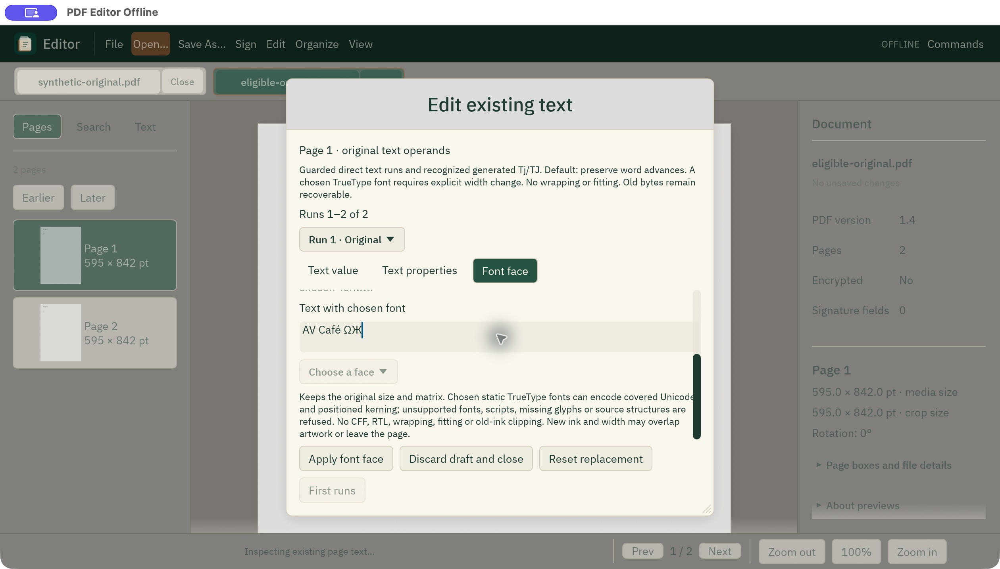
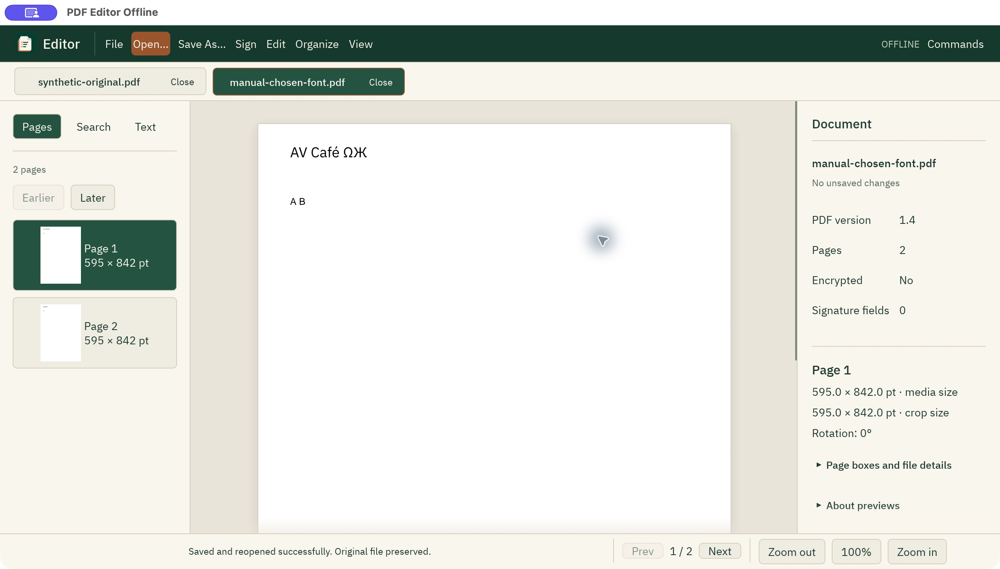

# Chosen TrueType existing-text fonts: actual macOS review

On 13 October 2026, frozen source `42cc2e5f034b2d11f324214f0727987519cd0662`
was reviewed in an actual macOS window through the supported native computer-use
APIs. This is source evidence, not a published-preview or other-platform claim.

The normal executable SHA-256 was
`64c181d9d6dd95cadd734992f5b188261cce31a358e24ce69269ce41bdfad5b8`.
The owned bundle was `/tmp/PDF Editor Offline Chosen Font Review.app`, ID
`io.github.othmaneblial.pdfeditoroffline.chosen-font-review`, observed PID 91348.
Its production `--pdf-worker` entry processed the actual edits. Other application
windows and recovery sessions were left intact.

## Actual window checks

The synthetic two-page source used shared Helvetica resources/content, explicit
`Tf`, `Tr 0` and `Tm`, with `Original` at `(40, 800)` and separate `A B` text at
`(40, 740)`. An initial fixture using relative positioning was correctly refused;
it was preserved separately rather than weakening eligibility.

- Existing-text **Font face** opened the native `.ttf` picker and selected the
  public IBM Plex Sans Regular asset. Apply was disabled until the visible
  width-change acknowledgment was checked.
- The scrollable body exposed **Text with chosen font**. Pasting `AV Café ΩЖ`
  updated the actual field. Apply painted that Unicode text on the real canvas.
- Actual menu Undo returned the clean original; Redo restored the edit and dirty
  state. Save As created `manual-chosen-font.pdf`, reopened it, and reported no
  unsaved changes.
- Reopening the existing-text dialog recognized the generated positioned run.
  Font face reported `Original embedded font: IBMPlexSans`; Text properties
  reported size 18 and matrix X/Y 40/800.
- Text value, with explicit width acknowledgment, accepted `AV Résumé ΩЖ` using
  the PDF's stored font. No second font picker was needed. Apply rendered it;
  Save As created and reopened `manual-repeat-unicode.pdf` cleanly.
- The actual quit guard protected the unapplied font draft. Return to editing
  retained the chosen font and acknowledgment.

The host keyboard layout maps the tool's `super+a` to actual Command-Q and
`super+q` to actual Command-A. The resulting quit guard was retained as evidence.
Clipboard delivery initially timed out while fields were clipped/unfocused;
scrolling the exposed body scrollbar, refreshing the exact bundle binding and
checking the selected text allowed normal paste. Accessibility `setValue` alone
did not update egui text. These are recorded interaction limits, not proof of
screen-reader completeness. No window-resize or pointer-placement claim is made.

## Independent saved-output checks

qpdf 12.4.2 `--check` passed both actual saved copies. Poppler 26.10.0 `pdftotext
-raw` returned exactly:

```text
AV Café ΩЖ\nA B\fOriginal\nA B\f
AV Résumé ΩЖ\nA B\fOriginal\nA B\f
```

The source catalog, page tree, untouched page and original font objects (IDs
1, 2, 4, 5) remained logically equal. The original decoded shared content stream
(ID 6) remained byte equal; the edited page used isolated new content/resources.
At 72 dpi, Poppler changed 876 pixels for the first edit, bounded by
`[40, 28, 136, 45]`, and 1,057 pixels for the second, bounded by
`[40, 28, 165, 45]`, compared with the original. Every pixel outside the edited
line region and all pixels of page 2 were unchanged. The selected font remained
byte equal to the repository asset. Original bytes remain recoverable: this is
text editing, not redaction.

Artifacts and full qpdf JSON/renders are preserved in
`/tmp/pdf-native-chosen-font-window-review-20261013`, with
`independent-proof.json`. SHA-256:

| Artifact | SHA-256 |
| --- | --- |
| Eligible original | `8c24cb21464ae6a1d91c623c5d99f953825942d2a5ed24e1de85d61d1911763f` |
| Chosen font | `975dcda37d80f038dcd143c22e33ca2d97a0cc5a929aace1c749153b0fe1afa5` |
| First saved copy | `2fab475c9da6c488bd5fc6cfe6b6699567830763f5e0e74e722fdcb9116e7a32` |
| Repeat saved copy | `a723b8584884ee191cb904da5bcb59fc5a78d8a21980b46a932c5f8c0eb8dde7` |

## Unmodified window captures

These are exact native screenshot bytes, not mockups or edited images.



SHA-256: `081ad6a9a01c25e90a56928c6eb29313964db8ece50d1f23668e2d528ca55a23`.



SHA-256: `e3f9a6d599cd7fcb6b644d26179c10480fdea51729b663b29713a74664d7a1bd`.


SHA-256: `dfdb53ea01a7084d0b5b8fb26c76fd7e0d654a145f2934c267acaf115c704829`.

Coverage remains the guarded static TrueType tier in
[the font guide](EXISTING_TEXT_FONT_RUST.md): no CFF, RTL, arbitrary source fonts,
paragraph reflow, missing-glyph substitution or guaranteed old-ink bounds.
