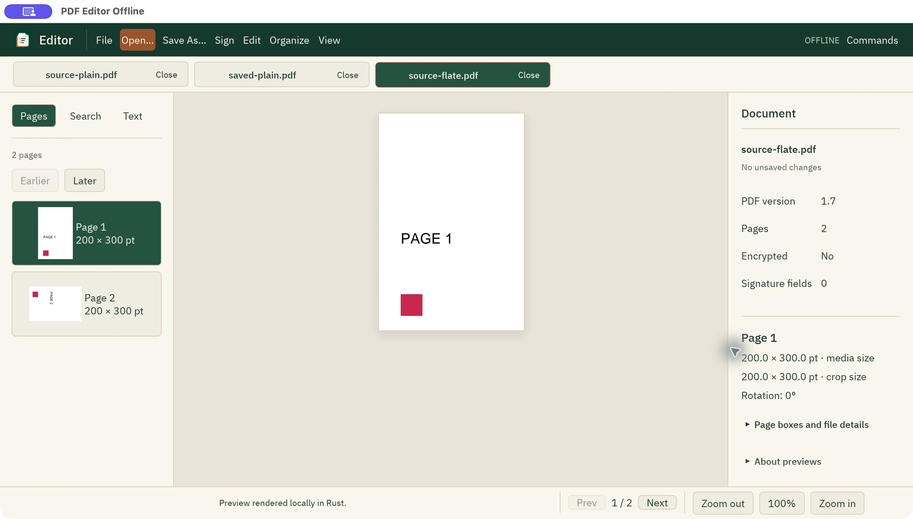
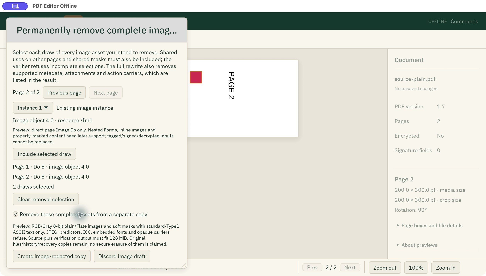
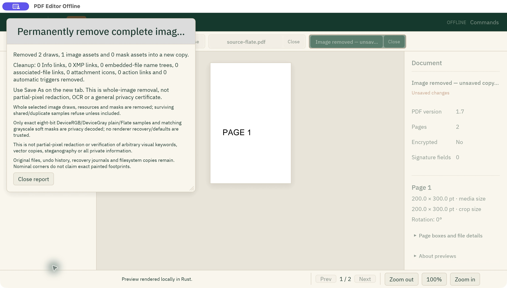

# Whole-image removal: actual macOS review

On 2026-10-13, the native macOS controls created, saved and reopened separate
image-removed copies of two public, independently authored PDFs. One contains a
plain RGB image; the other contains the same image with Flate transport. Both
have two pages sharing that asset, inherited standard Helvetica resources, ASCII
page text and a 90° second page. The original tabs and files stayed unchanged.

This reviews the restricted whole-image workflow described in
[Image redaction in Rust](IMAGE_REDACTION_RUST.md). It establishes no JPEG,
partial-pixel, arbitrary visual-keyword or general privacy guarantee. This OS
fixture has no soft mask; the checked core reference tests cover soft masks.
Windows and Linux were not exercised by this OS review.

## Exact source and artifact

The isolated checkout was clean at
`57ec7e89882d875629e0209aa17e036412b19fae`. A fresh normal native binary was built
with `CARGO_INCREMENTAL=0`, `cargo build --locked -p pdf-editor-offline-native`
and an external target directory. This was an **unoptimized debug review build**,
not a published release or reproducible-build claim.

The owned bundle was `/tmp/PDF Editor Offline Image Removal Review.app`.
Its executable SHA-256 was
`6689636138835df83ad28dfd76a3488fc2aeb5325e1e8bbc5bd7435c61036aed`.
Other applications and their review bundles were left untouched.

## Observed controls and results

The actual Open picker loaded each public fixture. **Edit → Remove complete
images into new copy…** displayed source-bound image inventory. Including only
page one's draw, confirming, and pressing Create refused with
`surviving shared image or mask use must be explicitly included`. The clean
original tab and selected draft remained; no copy appeared.

Including page two retained the first draw and reset confirmation. Confirming
both occurrences and pressing **Create image-redacted copy** produced a separate
unsaved tab. The result reported two removed draws, one image asset and zero
mask assets, along with actual cleanup categories and explicit privacy limits.

The copy's real Edit menu had Undo and Redo disabled. It contained no original
undo history. Actual Save As pickers published `saved-plain.pdf` and
`saved-flate.pdf`. Each saved tab was closed and its file explicitly reopened
through the picker. The reopened documents were clean; Undo/Redo still could not
restore the original image. Returning to the original Flate tab showed its image
on the rotated second page and no unsaved changes.

These steps exercised the production desktop's own `--pdf-worker` subprocesses,
the separate-copy journal path and verified Save As. They did not erase original
files, original history, recovery copies or other filesystem copies. The OS
fixtures started without prior edits; the actor regression separately verifies
that an original tab with existing undo history retains it unchanged.

## Independent checks of the actual UI-saved bytes

The verifier used qpdf **12.4.2** and Poppler **26.10.0**, checking their actual
versions before processing. The saved files came from the real Save As controls;
they were not replaced with generated test outputs.

- Both original files exactly matched the independent before-review controls
  after restoring their two authored `Do` operands.
- qpdf recovered the original RGB samples before removal. The saved full files
  and independently decoded QDF objects contained neither those samples nor the
  original encoded Flate body. Original image object 4 and content objects 5/7
  were absent; page image references and trailer `Prev`/`ID` were absent.
- All 15 page count, size, rotation and box records matched source/control.
  Complete extracted word-coordinate XML also matched exactly.
- On both pages of both fixtures, saved Poppler pixels exactly matched an
  independently authored no-image control. Source/control differed by 2883 RGB
  byte channels per page, corresponding to the reader's actual 31×31 painted
  footprint. No guessed rectangle padding or pixel tolerance was used.

Both saved files had SHA-256
`5edfe8f666bf7332f4b681b2fa53833e6197a1829bd87d12c548b41b3b925fbb`.
The complete local evidence directory is
`/tmp/pdf-image-removal-macos-57ec7e8-20261013`: public originals, controls,
actual saved PDFs, QDF/JSON, PPM pixels, generator, verifier, logs and twelve
unedited window captures. `PROOF.json` SHA-256 was
`1cbb98fac6357fb72a7e83aab92c13a8797e0eabf1de831412ee996d6cac5eaa`;
`PROVENANCE.json` SHA-256 was
`abf80d89277f6733ec74ce818b3b3d5c349d3192f953766607f096e50f302d96`.
These local temporary paths are evidence locations, not downloadable releases.

One clipboard paste timed out in the first picker; the native exact-path field
succeeded. A local verifier assertion was initially placed before its variable
declaration. The failing `verification-final.log` is preserved, and the complete
strengthened gate passed in `verification-final2.log`.

## Unmodified window captures

These are exact copies of the observed macOS windows, without cropping,
retouching or reconstructed controls.

The original Flate fixture shows its actual image on both pages:

Both source-bound occurrences are selected and explicitly confirmed:

The separate unsaved copy reports the removed assets and its limits while the
original tabs remain present:

