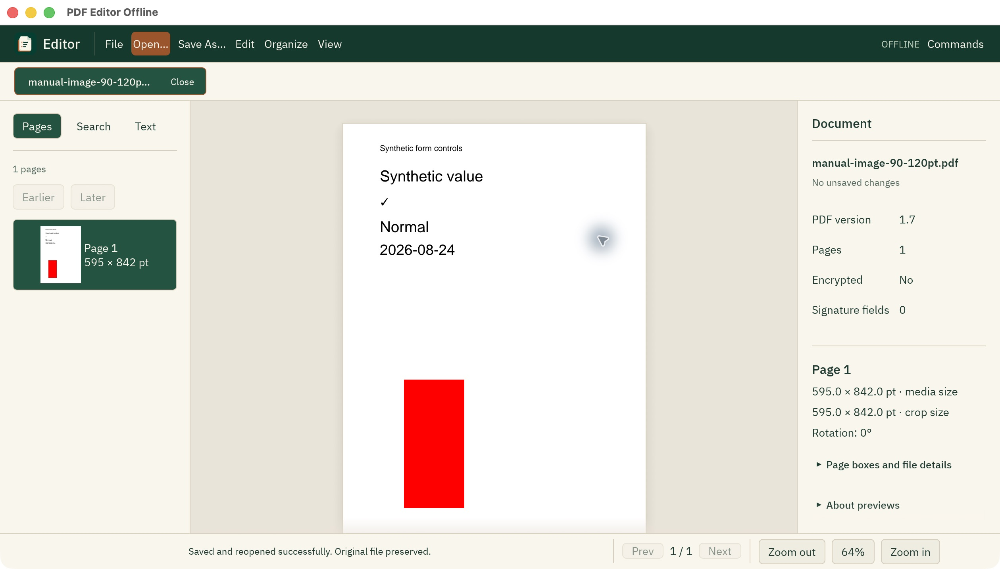

# Native desktop smoke evidence — 2026-10-12

## Actual image insertion and Save As — 2026-10-13

The checked image/drawing source corresponding to `d1eea25` was reviewed in an
owned temporary macOS app bundle. Its native executable SHA-256 was
`1e75b644a9d5272e3ab370a11c9e240e9415f00004a581ae243d77482942be58`.
The public synthetic `tests/fixtures/pdfs/forms.pdf` source remained unchanged
at SHA-256 `f937f8d02adf1341885163524107e33e365aefc07bf434f68dd64995f0c645dc`.

The real PNG picker, placement dialog, one-point arrow nudge, typed X coordinate,
90-degree rotation selection, Insert, Undo, Redo and Save As were exercised.
Competing menus/tab controls were disabled while the draft was open. The saved
copy reopened without unsaved changes; this is an actual app capture:

[The 15-second workflow slideshow](assets/image-workflow-2026-10-13.gif) uses six
genuine captures from this review, ordered as open, image dialog, zoomed
placement, inserted image, Undo and the saved copy. FFmpeg 9.0.1 scales the
2520×1436 captures to 1200×684 and assembles 30 frames at two frames per second.
There is no generated UI, invented cursor motion or claim of continuous screen
recording. The red fixture and manual interaction limits below remain unchanged.

[The actual saved PDF](assets/image-overlay-native-saved-2026-10-13.pdf) has
SHA-256 `a77cd1ef650f2fb578995ca63e54a7aa538e8ee1e8e26dc04e7159b35dc896f9`.
Pinned qpdf 12.4.2 accepted it. Poppler 26.10 retained exact text and geometry;
18 original semantic objects were unchanged except the selected page and xref
transport. All 30,107 changed pixels were inside the entered image rectangle
`[120,84.2,238,336.8]`. The saved matrix `0 252.6 -118 0 238 84.2` verifies the
chosen quarter-turn; the uniform red fixture does not prove asymmetric visual
rotation.

Canvas drag/resize attempts did not change the rectangle, so those manual
interactions remain unverified. Drawing tool/fill/opacity controls worked, but
manual vector creation/Apply and close-draft guards were not completed.
Supported automation later lost app access (`AXError.cannotComplete`). No system
accessibility or security settings were changed. This review does not establish
all-platform runtime behavior, signing, accessibility or complete PDF fidelity.

## Production subprocess checkpoint — 2026-10-13

The Rust `4.0.0-preview.1` desktop was rebuilt with
`cargo build --locked -p pdf-editor-offline-native -p pdf-editor-offline-cli`,
without the test-helper feature. The resulting native debug binary has SHA-256
`8601076198ecea00ab622dd279ed3630f5e8bc24dcdb1fb3e3b5e151f07e78b4`.
Only the owned temporary `/tmp/PDF Editor Offline Review.app` was refreshed;
the previous binary was preserved outside the repository. This is a local debug
build, not a signed installer or a published native binary release.

An external temporary Rust harness used the production transport and that exact
bundle executable with `--pdf-worker`. Every request ran through the native
binary's early worker entry, rather than a standalone test helper. Against the
public `tests/fixtures/pdfs/forms.pdf`, the six child operations passed:

- Document info returned one unencrypted, unsigned page with a 595×842-point
  MediaBox and CropBox and rotation 0.
- Rendering at scale 2 returned an actual 1190×1684 RGBA payload of 8,015,840
  bytes; the returned dimensions matched its byte length.
- Page-text extraction returned `Synthetic` without truncation.
- Rotation returned a verified PDF with rotation 90.
- Metadata editing retained that rotation and set the title to
  `Subprocess smoke Résumé 中文 ✓`.
- Prepare Save returned verified PDF bytes, written by the harness to a new
  temporary output using exclusive creation. This did not exercise the native
  Save As dialog or the parent GUI's history and publishing flow.

The independent native CLI and pinned Poppler 26.10.0 read the exact Unicode
title and rotation 90 from
`/tmp/pdf-editor-subprocess-smoke-20261013/production-worker-output.pdf`.
Poppler text extraction retained the synthetic form text, and qpdf 12.4.2 found
no syntax or stream-encoding errors. The output SHA-256 is
`72d16b0bfb634eae0be2083f47c59dd944da76fea53ab23681e5d3f30c696cfb`.
The source SHA-256 before and after was unchanged:
`f937f8d02adf1341885163524107e33e365aefc07bf434f68dd64995f0c645dc`.
These checks establish the stated structural/text boundaries, not complete
raster fidelity or preservation of every possible PDF feature.

The integration's explicit 53-test native suite and strict all-target Clippy
passed before this production rebuild. Actual GUI smoke for this subprocess
milestone remains pending: the computer-use service reported `cgWindowNotFound`
for both the prior review binary and the rebuilt running bundle, through exact
path and registered bundle ID. A second review session reproduced the same
acquisition failure. No current-build GUI opening, search, rotate/undo/redo,
properties editing or Save As interaction was observed, and no new GUI capture
is claimed. The genuine screenshots below remain evidence for their identified
earlier binaries.

The subsequent thumbnail preview has 30 passing automated tests, including actual
PDF raster pixels, bounded texture-cache eviction, visible-only thousand-page
scheduling and foreground priority. A one-shot initial visibility command avoids
eframe's hidden-window first-paint cycle. Temporary diagnostics confirmed the
constructor, logic and UI callbacks run; no logging remains in source.
The computer-use surface initially failed to acquire this build's window
(`cgWindowNotFound`), including a fresh temporary bundle and control-session reset.
Window acquisition later recovered. The additional review below records actual
thumbnail, properties and image/blank-page interactions; older captures remain
evidence for their earlier workstation build.

The organizer milestone raises the native test count to 36: move/reverse, blank
insertion, numeric crop, verified save/reopen and complete undo are tested on an
actual three-page PDF, including signature and failed-edit guards. The render
worker also tests fixed-size sticky notes at zoom 2 and DPR 1/2. These are automated
behavior checks; organizer dialog and thumbnail runtime review remain pending.

The properties and CJK fallback milestone has 43 passing native tests. Metadata
updates preserve aliases, dates and XMP through save/reopen and undo; failed or
stale drafts remain copyable, including actual small/large headless UI passes.
Actual font-atlas tests verify common Chinese, Japanese and Korean glyphs. These
checks do not replace runtime properties-dialog review or a screen-reader audit.

## Subsequent real-window review

The debug binary reviewed for properties, image import and organization has
SHA-256 `e18bd263d8958562a40c03223fd883a78a4c98085dfb546892a73ceab7e82c26`.
Its application sources were subsequently committed as `e0062d3` and `7ee8d52`.
The earlier thumbnail capture uses the reviewed properties/CJK binary with
SHA-256 `38469031469e883df9a41c1571cae9870c2a71d3ec69ae10a4ea189a67533543`.
Both were run in a temporary native macOS bundle; neither is a signed installer.

- Opened the public `demo-basic.pdf` through the native file picker and observed
  a real thumbnail matching its page. [Actual thumbnail capture](assets/screenshots/native/thumbnails-light-2026-10-12.png)
  has SHA-256 `cd60e3056c1c0b1e7599930ccbbe378490acf0c3f7ddf66a8fba9a9e94890ff7`.
- Entered `Résumé 中文 東京 한국 ✓` in Document properties. The glyphs render,
  Apply/Cancel remain visible and the loaded-status message clears the earlier
  reading message. [Actual properties capture](assets/screenshots/native/properties-cjk-2026-10-12.png)
  has SHA-256 `7affbed46a0aeb6dfe9891c53c3588fc1298457ba1f459234e9da86e4ed1c53c`.
  Applied the title and saved `/tmp/pdf-editor-properties-cjk-20261012.pdf` using
  the native save panel. Both the native CLI and pinned Poppler read the exact
  title back; the source fixture has no Git diff.
- Imported a synthetic red 2×3 PNG using File → Images to PDF. A new unsaved tab
  appeared beside the preserved previous document. Inserted a 300×420-point blank
  page using actual numeric entry, moved it after the image and saved
  `/tmp/pdf-editor-native-images-organized-20261012.pdf`. qpdf 12.4.2 reports no
  syntax/stream encoding errors; Poppler 26.10.0 reports the two expected page
  boxes in that order. Independently decoded image samples are exactly six red
  RGB pixels. [Actual blank-page dialog](assets/screenshots/native/organizer-blank-2026-10-12.png)
  has SHA-256 `d3e14fec544480e2ffcfba14d967738b0dba267f0713295a1eea935899adb847`.
- Undo restored the earlier blank/image order and marked the document dirty.
  Redo restored the saved image/blank order and the clean state.
- Applied a 280×400-point CropBox to the blank page while its MediaBox stayed
  300×420. The inspector reflected both dimensions; Undo restored the saved
  CropBox and clean state. [Actual crop dialog](assets/screenshots/native/organizer-crop-2026-10-12.png)
  has SHA-256 `99720292b5debeab8b070a61b33fe124f30a401b0ee8f2e04b786596e86a0c2a`.
  Its visible warning explains that cropping retains hidden content. This
  blank-page check does not prove secure removal or clipping of real artwork.

Accessibility value assignment did not change numeric steppers; physical double
click, typing and Return did. A focused title field supported actual paste and
text selection. Multiple file selection was not achieved through the automation
keyboard, so only single-image picker import is claimed. Ordered multi-image
conversion has automated tests. Reverse-page interaction, thousand-page scrolling,
latest dark/compact properties review and other-platform interaction remain open.
The current native suite has 49 passing tests, including a regression that checks
actual painted action labels against clipping at 640×420 and 1260×718.

Tested a locally compiled debug native application on macOS Apple Silicon using
real native window and file-dialog interactions. This is a development preview,
not a signed/notarized installer or full feature-parity claim.

Observed: local opening of `examples/sample_pdfs/demo-basic.pdf`, actual page
raster, rotation right, dirty-tab marker, Undo restoring the clean state, Redo
restoring the edit, and Save As to `/tmp/pdf-editor-native-cua-20261012.pdf`.
The UI reported successful reopened saving and cleared the dirty marker.

Recorded independent inspection asserted: original rotation 0°, output rotation
90°, unchanged extracted text, and one page in both. A subsequent edit and Close
displayed an unsaved-change prompt, disabled background controls, and Keep editing
retained the tab and dirty state. Undo returned to the saved state.

Real captures: [rotation/save](assets/screenshots/native/rotation-save-2026-10-12.png)
and [unsaved guard](assets/screenshots/native/unsaved-guard-2026-10-12.png).
The GUI binary used for these captures had SHA-256
`94520ed1d82969d6a4041075b66da26df97a801650848b88783e8f07f7360038`.
It precedes the later core resource/extraction fixes and workstation redesign.
The final workspace desktop build, seven state/history tests and strict Clippy
also passed after those core fixes. Screenshots are not proof of other workflows.

Not established: Windows/Linux GUI behavior, all renderer fidelity, VoiceOver
document-text access, large-document responsiveness, multimonitor behavior,
crash recovery, total hostile-input memory/time isolation or release packaging.

## Workstation, search and Retina check

The redesigned native preview was exercised on the same macOS host with the
actual `tests/fixtures/pdfs/forms.pdf` (the corpus path before cleanup was different). Literal `Synthetic` search found page 1,
reported scanning 1/1, disabled Stop after completion and showed
`Search complete: 1 matching page.` The result excerpt and accessibility tree
contained the visible `✓`; the embedded fallback displayed the actual glyph.
The Retina canvas was visibly sharp at 100%; zoom changed to 125% without changing
document geometry. Physical 2× render sizing also has an automated real-PDF test.

Command+K opened the actual palette. Filtering and Enter executed rotation and
theme commands; Escape dismissed it. File → Quit correctly guarded the dirty tab.
The first actual Command+Q test exposed Winit's native `terminate:` menu bypass.
Disabling its default native menu routed Command+Q through the app guard; the
rebuilt binary showed the unsaved prompt and retained edits after Return to
editing. Undo restored rotation 0° and the clean state. The French AZERTY host's
automation uses physical key positions: tool `super+a` produced logical Command+Q,
and `super+w` produced Command+Z. The application uses standard logical shortcuts.

Fresh captures from the fixed binary:
[search/Retina](assets/screenshots/native/workstation-search-retina-2026-10-12.png),
[dark palette](assets/screenshots/native/workstation-palette-dark-2026-10-12.png),
[actual Command+Q guard](assets/screenshots/native/workstation-quit-guard-2026-10-12.png).
Binary SHA-256: `53fac9c411c8a1827c382ec8ff85201f7373db0feba32171c3bf97aa12a0a7dd`.
Twenty desktop tests, strict Clippy, formatting and build passed.

AX activation/value assignment did not reliably focus or update the search field;
clicking its visible coordinates and pasting worked. Text was exposed in the
accessibility tree, but full VoiceOver interaction is unverified. Dock/system
termination, multimonitor DPI transitions, large-document scrolling and the
resolution-cap notice on an actual oversized document were not exercised.

## Editorial visual revision

The next native build introduced pinned IBM Plex Sans typography, ivory panels,
forest chrome/selection, copper actions and a corresponding dark theme. The same
real form fixture was checked in both themes. Command+F focused the actual query;
pasting `Synthetic` and pressing Enter found page 1, kept query focus and exposed
the compact original-text excerpt in the accessibility tree.

Resizing to roughly 892×521 logical points collapsed the inspector and retained
the search/navigation controls. At roughly 1261×462 points the inspector remained
visible; scrolling reached its advanced details and extracted-text checkbox.
Palette rotation, actual Command+Q's unsaved guard and Undo back to a clean 0°
document were rechecked after the styling change.

Actual captures: [light](assets/screenshots/native/editorial-light-2026-10-12.png),
[dark](assets/screenshots/native/editorial-dark-2026-10-12.png),
[compact](assets/screenshots/native/editorial-compact-2026-10-12.png) and
[quit guard](assets/screenshots/native/editorial-quit-guard-2026-10-12.png).
Binary SHA-256: `4a87784262b4253437aa4d03cc030ecf86d8b137f02ce56ede61e0d0c381d606`.
Twenty-four tests, formatting, strict Clippy and build passed. Contrast tests
cover critical theme text; they do not certify full accessibility. The previous
platform, screen-reader, worker-isolation and release-packaging limits still apply.
