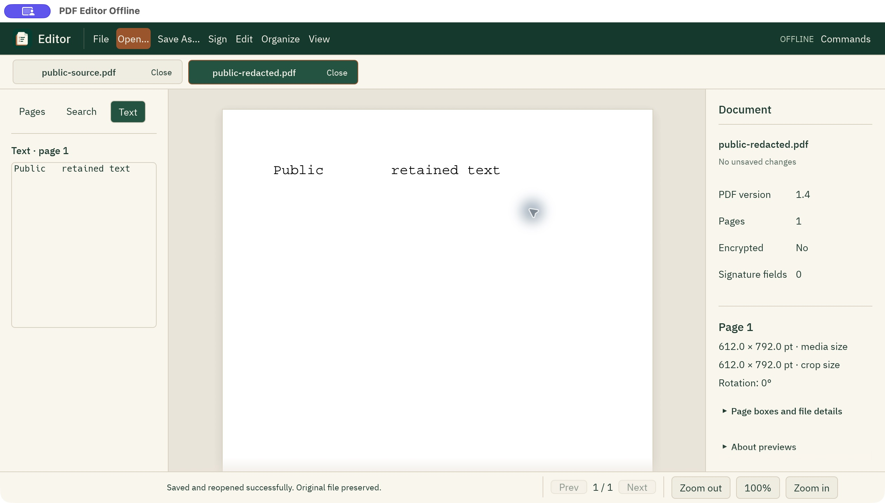

# Native text-redaction review

The actual macOS window was reviewed on 13 October 2026 using a generated public
one-page Courier PDF containing `Public SECRET retained text`. No customer
document was used. This review covers source `d8bfc1b`, later than published
preview.4; it is not desktop-installer or all-platform evidence.

## Actual window flow

- Open the public PDF through the native picker.
- Open **Edit → Create permanent text redacted copy…**.
- Enter the exact target with real keyboard input and select the explicit
  separate-copy confirmation. The action stays unavailable without a valid request.
- Create a verified copy in a separate unsaved tab; the completion report records
  one match, one changed text show and one removed old/unreachable object.
- Read the new tab's extracted text, then Save As `public-redacted.pdf` through
  the native picker. The editor reports successful save/reopen and no unsaved changes.
- Inspect Edit: Undo and Redo are unavailable in the new copy, so its history
  cannot restore the source secret. Switching to the original tab still shows
  `Public SECRET retained text`; switching back shows the redacted result.

Initial accessibility click/type did not focus the target field. The supported
field setter established focus, after which real keyboard input worked. A file
picker paste timed out; its supported field setter completed navigation. These
automation observations are not proof of every pointer or accessibility flow.

## Independent saved-file checks

qpdf 12.4.2 accepted both PDFs. The isolated Rust CLI's `verify-redaction` checks
the actual saved bytes and reports the supported
`ascii-standard-type1-text-state-v3` profile, without claiming a general privacy
certificate or erasure of other files.

Poppler 26.10.0 extracts the source target, then `Public   retained text` from the
saved copy. Every retained word's exact bounding-box record is identical.
At 72 DPI, **498 pixels change, with zero changed pixels outside the source
target's independently extracted word box plus one pixel of raster padding**:
`[155, 78, 229, 97)`. qpdf's complete decoded rewrite contains no `SECRET` bytes.
These observations cover this fixture; the broader profile has dedicated tests.

| Artifact | Bytes | SHA-256 |
| --- | ---: | --- |
| Public source PDF | 600 | `d341877680c9b8f1fe801e47e62e148145798dcae7e52d2f7f5ce2b112689ac9` |
| Saved redacted PDF | 602 | `a5a567974ca692b7724db82e4590dd95ca8810182ae92d4e817720509ba6cf1f` |
| Exact unmodified screenshot | 236617 | `c15b243c9c51950711d07618168e56f18d7c04d483a8287051aec6e09f35e0e9` |
| Reviewed normal native executable | 94976520 | `dcbc984f10064c9c7600832e4a57b5a42b296e24fce8313f5dcce1395e2a40b7` |

The executable was copied from the normal workspace build into a separate local
review bundle; it is unsigned and unnotarized. Local fixtures, outputs and bundle
are under `/tmp/pdf-native-redaction-window-review-20261013`.

The same frozen source passed **746 workspace tests across 89 suites, zero
failures and zero ignored tests**, with the worker helper and all qpdf/Poppler
gates enabled. Normal builds, formatting, workflow lint and strict workspace
all-target Clippy passed. Logs are `/tmp/pdf-stage22-normal-build.log`,
`/tmp/pdf-stage22-pinned-workspace.log` and
`/tmp/pdf-stage22-workspace-clippy.log`.

Manual short-window behavior, refusal/draft/quit interactions, recovery restoration
and other operating systems remain separate gates. Arbitrary PDFs, images,
custom/embedded fonts, region redaction and general private-data removal remain
unfinished. [Exact proof boundary](TEXT_REDACTION_RUST.md).
