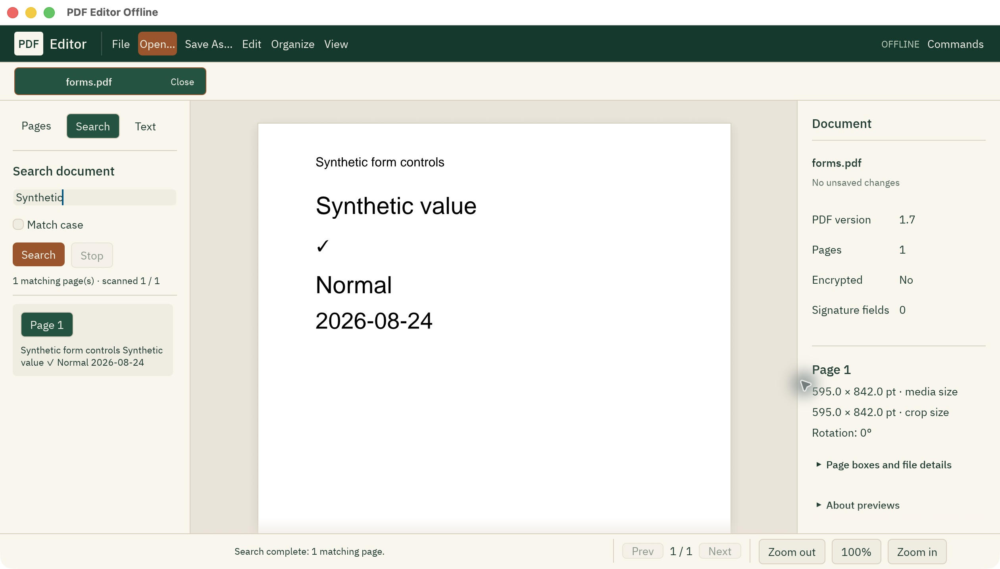

# PDF Editor Offline

**关注项目进展：** [最新提交](https://github.com/OthmaneBlial/pdf-editor-offline/commits/main/) · [原生测试](https://github.com/OthmaneBlial/pdf-editor-offline/actions/workflows/rust.yml) · [路线图](../../ROADMAP.md)。试用一个工作流程，并使用不含私人数据的示例 PDF 参与改进。如果工具对你有用，欢迎[为项目点星](https://github.com/OthmaneBlial/pdf-editor-offline)。

**源码新功能：**通过拖动和调整大小手柄放置新增文字，将 PDF 拆分到新标签页，并使用密码对话框打开受保护的文档。加密文件保持只读；恢复记录不会保存解密内容或密码。已发布的 CLI 仍为 `4.0.0-preview.3`。

[Encrypted viewing](../ENCRYPTED_VIEWING_RUST.md) · [Canvas text placement](../TEXT_OVERLAYS_RUST.md) · [Split workflow](../../apps/desktop/README.md)

**用 Rust 编写的离线 PDF 编辑器。文件始终留在你的电脑上。**

[English](../../README.md) · [Français](fr.md) · [العربية](ar.md) · [Español](es.md) · [Português](pt-BR.md) · [Deutsch](de.md) · [简体中文](zh-CN.md) · [日本語](ja.md) · [한국어](ko.md)

[](https://github.com/OthmaneBlial/pdf-editor-offline/actions/workflows/rust.yml) · [MIT](../../LICENSE)

**当前源码的新功能：** 将兼容的 PDF 合并为新副本，在页面上添加 Unicode 文本，并管理基本便笺，支持撤销和重做。体验这些功能需要从源码构建；已发布的 CLI 仍为 `4.0.0-preview.3`。[文本示例](../TEXT_OVERLAYS_RUST.md) · [便笺说明](../NOTES_RUST.md)（英文指南）。添加文本或普通删除便笺并不等于安全擦除敏感数据。

打开 PDF，找到需要的页面，调整文档，然后保存一份新副本。PDF Editor Offline 提供免费、开源的桌面应用和命令行工具，无需账号、订阅或上传文档。

目前是原生 Rust 预览版。请从源码构建桌面应用以体验当前版本。目标平台为 macOS、Windows 和 Linux；实际桌面交互验证主要在 macOS 上进行。桌面安装包和完整 PDF 编辑功能仍在开发。[原生 CLI 预发布版 4.0.0-preview.3](https://github.com/OthmaneBlial/pdf-editor-offline/releases/tag/v4.0.0-preview.3)现已提供；[历史桌面发行版本](https://github.com/OthmaneBlial/pdf-editor-offline/releases)属于早期构建。



## 当前可用功能

| 任务 | 可用功能 |
| --- | --- |
| 阅读与搜索 | 桌面提供标签页、缩放、可见页面缩略图、文本视图、字面搜索和明暗主题；CLI 提供信息查询、文本提取和有限的文本/几何比较。 |
| 页面整理 | 桌面支持移动、反转、旋转、插入空白页、裁剪以及撤销/重做；CLI 支持受限制的页面提取/删除和简单目录结构的合并。 |
| 文档属性 | 读取和编辑六个标准字段，支持 Unicode：Title、Author、Subject、Keywords、Creator、Producer。 |
| 图像与注释 | 将支持的 PNG/JPEG 转为 PDF 页面；CLI 可导出单页 PNG，并添加、列出、有限编辑和删除 Text 便笺。 |
| 检查与保存 | CLI 只读检查动作、附件、表单和图层标记，进行无损流压缩；保存经验证的新副本，不覆盖已有文件。 |

合并、页面子集、便笺编辑和图像转换均有明确限制。不支持的结构会被拒绝，详见 [CLI 指南](../../apps/cli/README.md)。压缩不保证文件变小。裁剪只是隐藏内容；删除元数据或便笺可能留下旧值，不等于安全擦除。预览版尚不支持 OCR、高级文本字段（分格或富文本）填写、数字签名、任意页面文本编辑或通用文档转换。渲染器可能遗漏不支持的内容，请检查导出的文档。已签名及成功解密的输入仅可读取。

当前源代码可识别 AcroForm 字段，并填写受支持的复选框和单选按钮，保留原有外观流。[示例与限制](../FORMS_RUST.md)。已发布的 npm CLI `4.0.0-preview.3` 支持填写这些按钮字段。

仅在当前源代码中，受支持的单行和多行文本字段可填写 Unicode 文本，须明确选择覆盖完整值的 TrueType 或 CID CFF1 字体。多行字段保留显式换行，并按字段宽度自动换行。排版适配有明确限制：溢出、缺失字形或不支持的布局会被拒绝，不会截断文本。

当前源码可使用从零开始的选项索引和用户明确选择的字体，填写受支持的下拉框、单选列表和多选列表。文本与选项字段填写尚未包含在已发布的 CLI `4.0.0-preview.3` 中；可自由输入的下拉框及不支持的布局会被拒绝。

界面目前为英语。这些说明文档翻译不代表 GUI 已本地化，也不代表完整支持从右到左的布局。离线字体包含已测试的中文、日文和韩文字形，但不能覆盖所有文字系统。

## 安装原生 CLI（可选）

通过 npm 安装及使用其启动器需要 Node.js 22+。独立的 CLI 可执行文件不需要 Node.js。桌面应用仍需从 Rust 源码构建。

```sh
npm install --global pdf-editor-offline
pdf-editor-offline --help
```

### 用自己的 PDF 试一试

将 `input.pdf` 替换为本地文件。第一条命令读取文档信息，第二条验证旋转操作但不写入，第三条创建新副本。请选择尚不存在的输出文件名。

```sh
pdf-editor-offline info input.pdf --json
pdf-editor-offline rotate input.pdf --pages 1 --degrees 90 -o rotated.pdf --dry-run --json
pdf-editor-offline rotate input.pdf --pages 1 --degrees 90 -o rotated.pdf --json
```

## 构建与运行

安装 Rust 1.95+ 以及平台所需的原生构建库。首次下载依赖需要联网。Linux 系统包请参考[原生 CI 配置](../../.github/workflows/rust.yml)。

```sh
git clone https://github.com/OthmaneBlial/pdf-editor-offline.git
cd pdf-editor-offline
cargo build --release --locked -p pdf-editor-offline-native -p pdf-editor-offline-cli
./target/release/pdf-editor-offline-native
```

```sh
./target/release/pdf-editor-offline info examples/sample_pdfs/demo-basic.pdf --json
./target/release/pdf-editor-offline rotate examples/sample_pdfs/demo-basic.pdf --pages 1 --degrees 90 -o rotated.pdf --dry-run --json
./target/release/pdf-editor-offline rotate examples/sample_pdfs/demo-basic.pdf --pages 1 --degrees 90 -o rotated.pdf --json
./target/release/pdf-editor-offline capabilities --json
```

Windows 使用 `target\release\pdf-editor-offline-native.exe`。页码从 1 开始。`--dry-run` 只验证，不写文件。请选择新的输出路径；已有文件和符号链接不会被覆盖。

## 本地处理，可核对结果

PDF 操作在本机完成，不使用远程渲染或云转换服务。这并不能证明每份 PDF 都安全，也不能证明所有隐藏信息已被清除。[CLI 验证记录](../RUST_BENCHMARKS.md)包含 44 项操作检查、qpdf/Poppler 独立验证、实际进程耗时和哈希，其中包括一份生成的 1,000 页 PDF。这些结果不证明所有文档都能完整还原、桌面响应流畅或普遍提速。

欢迎提供可复现的合成 PDF 测试案例、渲染对比、无障碍测试、翻译修正和小型 Rust 改动。请勿在公开报告中附上私人文档。

```sh
cargo test --workspace --locked
cargo clippy --workspace --all-targets --locked -- -D warnings
```

[Status](../RUST_STATUS.md) · [Desktop](../../apps/desktop/README.md) · [CLI](../../apps/cli/README.md) · [Security](../SECURITY_INSPECTION_RUST.md) · [Screenshots](../assets/screenshots/native/)

如果你需要在本地工作的 PDF 编辑器，欢迎给仓库点一颗星，帮助更多人找到它。

采用 MIT 许可证；字体和依赖保留各自的许可声明。
